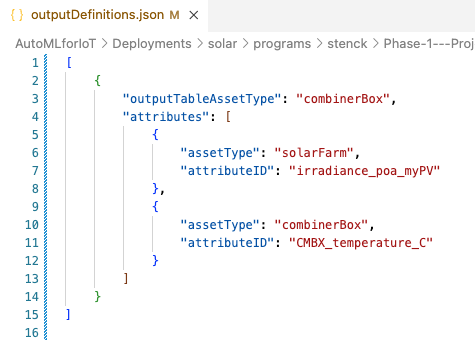
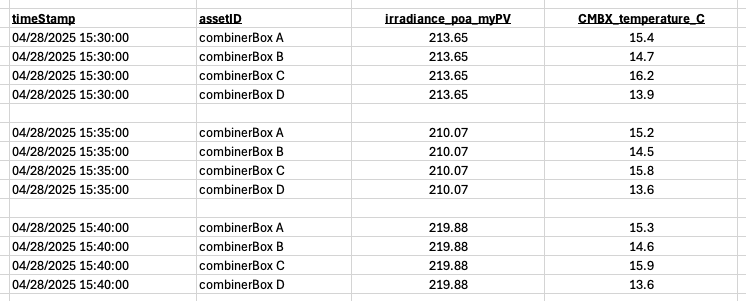
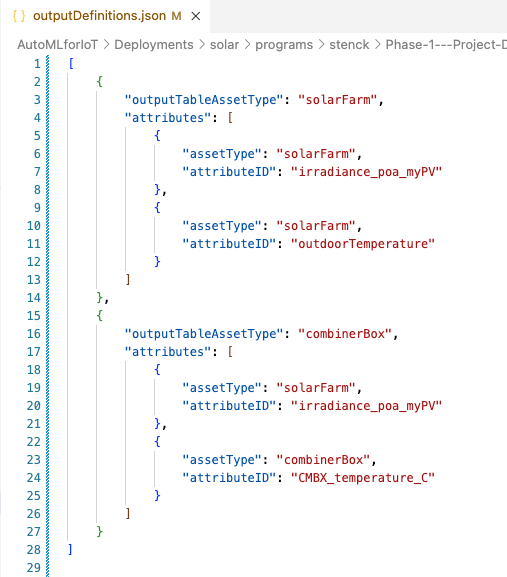
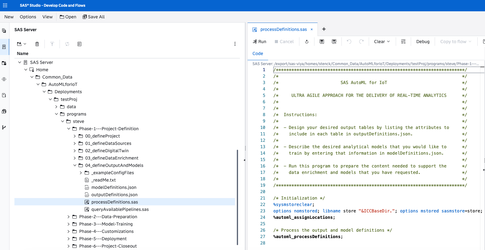

# Design Output Tables

## What You Are Doing in This Step

At this point, you have already defined the digital twin: the asset types, the attributes associated with them, and any relationships between assets.

Now you simply decide **what output tables you want AutoML for IoT to create**.

For each output table, answer two questions:

1. **Which asset type should the table be built for?**
2. **Which attributes from across the digital twin should be included as columns in that table?**

That is the basic idea.

AutoML for IoT can retrieve attributes from connected assets automatically, so the columns in a table do not have to come only from the asset type that the table is built for.

## Example

Suppose the digital twin contains:

```text
solarFarm
    ↓
inverter
    ↓
combinerBox
    ↓
string
```

You might want a table with one row for each `string`.

That table could include information from the string itself and from higher-level connected assets:

| Column in the string table | Attribute |
|---|---|
| String ID | `string/stringID` |
| String current | `string/current_A` |
| Combiner-box ID | `combinerBox/combinerBoxID` |
| Combiner-box temperature | `combinerBox/combinerBoxTempF` |
| Solar-farm ID | `solarFarm/solarFarmID` |
| Irradiance | `solarFarm/irradiance_poa_myPV` |

When the output table is assembled, AutoML for IoT can retrieve the requested attributes from connected assets in the digital twin.

## You Can Create More Than One Output Table

Most projects can define multiple output tables.

For example, the same solar project might create:

- a `solarFarm` table with one row per solar farm
- an `inverter` table with one row per inverter
- a `combinerBox` table with one row per combiner box
- a `string` table with one row per string

Each table can contain a different set of attributes based on how that table will be used.

The configuration simply repeats the same pattern for each table:

**choose the table's asset type → choose the attributes to include**

## Where the Configuration Goes

Define output tables in:

```text
Phase-1---Project-Definition/
└── 04_defineOutputAndModels/
    └── outputDefinitions.json
```

Use `outputDefinitions.json` to define each output table and the attributes that should be included in it.

## Specify the Tables in `outputDefinitions.json`

Once you know which tables you want and which attributes belong in each one, enter those definitions in `outputDefinitions.json`.

The fields described below translate the choices you just made into the configuration AutoML for IoT uses to build the tables.

An example json looks like the following:



## Choose the Output Table Asset Type

Each output table is associated with one:

```text
outputTableAssetType
```

The value must be a valid asset type in the project.

For example:

```text
combinerBox
```

creates a table focused on combiner-box assets.

If the project contains ten combiner boxes, the output contains one record for each combiner box at every output interval.

You can define one output table or multiple tables for different asset types.

## Choose the Attributes to Include

Each output definition contains an `attributes` list.

Every item identifies an attribute using:

```text
assetType/attributeID
```

The selected attribute can be either:

- a raw attribute
- a derived attribute

The selected asset type must exist, and the corresponding `assetType/attributeID` must exist in the project's raw or derived attributes.

## Attributes Can Come from Connected Asset Types

The attributes in an output table do not all need to belong to the output table's asset type.

For example, a table focused on:

```text
combinerBox
```

could include:

```text
combinerBox/CMBX_temperature_C
solarFarm/irradiance_poa_myPV
```

provided the relationship used to obtain the connected solar-farm value is unambiguous.

This allows one output record to contain useful context from across the digital twin.

Do not request an attribute from a connected asset type when multiple assets could qualify and it would be unclear which value should be selected.

When the relationship is ambiguous, define an appropriate derived attribute first. For details about the available relationship-based calculations, see [Configuring Derived Attributes](../configuring-derived-attributes/README.md).

## Configuration Structure

Output tables are defined in:

```text
04_defineOutputAndModels/outputDefinitions.json
```

Each output definition contains exactly two required fields.

| Field | Type | Description |
|---|---|---|
| `outputTableAssetType` | string | Asset type for which the output table is generated. Must exist in the asset-type definition. |
| `attributes` | array | Non-empty list of attributes to include in the table. |

Each object inside `attributes` contains exactly:

| Field | Type | Description |
|---|---|---|
| `assetType` | string | Asset type containing the selected attribute. |
| `attributeID` | string | Raw or derived attribute to include. |

There are no optional fields in an output definition.

## Example

Below is an example combiner-box output table whose columns are selected from the digital twin.


## Understand the Resulting Columns

The output column name is always the selected attribute's:

```text
SASAttributeID
```

For example, if the configuration selects:

```text
combinerBox/CMBX_temperature_C
```

and its SAS attribute ID is:

```text
CMBX_temperature_C
```

then the output table column uses that SAS-compatible name.

Below is an illustration of the resulting records as rows are generated at the configured project interval.



When reviewing an output definition, think about it in two ways:

- **configuration reference:** `assetType/attributeID`
- **resulting dataset column:** `SASAttributeID`

## Multiple Output Tables

A project can define multiple output tables.

For example:

- one table can focus on the entire solar farm
- another can focus on combiner boxes

Each definition independently selects its output asset type and desired columns.



The exact output values depend on the project, but the structural rule is consistent: one row per timestamp per asset ID of the selected `outputTableAssetType`.

## Validate an Output Definition

Before processing the definitions, confirm that:

- `outputTableAssetType` identifies a valid asset type
- `attributes` is not empty
- each listed `assetType` exists
- each `assetType/attributeID` exists as a raw or derived attribute
- the same attribute is not duplicated within the output definition
- connected-asset requests are unambiguous
- only the documented fields are present

## Integrate and Check the Definition

After the output definitions are complete, open and run:

```text
04_defineOutputAndModels/processDefinitions
```

The program checks the output and model definitions and integrates them into the project.



Review the log or generated review information and resolve any validation issues before continuing.

## Previous

For an overview of when to define output tables, models, or both, see [Designing Output Tables and Models](README.md).

## Next

If the project will train and deploy machine learning models, see [Specify Models to Train and Deploy](models.md) for target, predictor, grouping, pipeline, and training-period configuration.

## Related Information

If the output requires a connected value that is currently ambiguous, see [Configuring Derived Attributes](../configuring-derived-attributes/README.md) for ways to make the relationship explicit before adding the field to the output table.
