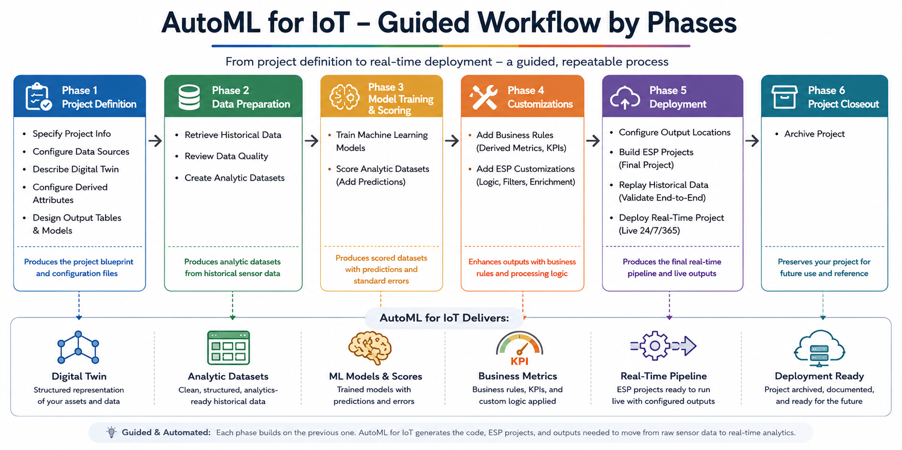

# SAS AutoML for IoT - Enablement Home

## What is SAS AutoML for IoT?

SAS AutoML for IoT is an automated approach to simplify solving your real-time analytics use case. Users configure a digital twin of their use case, enrich it with new calculated metrics, integrate machine learning models for key measures, and then deploy their final project to run live 24/7/365. And all of this is done using a few simple configuration files that a subject matter expert can provide.

## Getting Started with SAS AutoML for IoT 

This is the main navigation page for the enablement site for SAS AutoML for IoT. It is intended to provide users of all backgrounds a central location for all of the content needed to help them be successful.

The below links provide a more detailed introduction to SAS AutoML for IoT, shows how to install it, and demonstrates how to set up your first project.

- [Introduction](../README.md)

- [Installation](../installation/README.md)

- [Setting Up Your First Project](../setting-up-your-first-project/README.md)

## I understand the basics - how do I tackle MY use case?

SAS AutoML for IoT is a guided process that leads the user through all of the necessary steps to complete their project. Users have two options...

- [Follow step-by-step instructions](#step-by-step-instructions) to complete each part of the process

- [Chat with an AI assistant](../working-with-the-ai-assistant/README.md) regarding your use case. The assistant is aware of the capabilities of the approach and is well versed in the structure of every configuration file needed. In addition, it can provide useful suggestions at many steps of the process which can enrich your project with new ideas you may not have otherwise considered. At the end of the conversation, the assistant will provide you with a consolidated json file that you can import into AutoML for IoT.

### Step-by-Step Instructions

This section provides step-by-step instructions for each step of AutoML for IoT's guided process. 

It is organized to match the structure of each project directory. As you configure your project, refer to the applicable directory below for guidance related to each step. Note that most screenshots have been taken in Viya, but the steps are almost identical in Viya Workbench. Model training is different in Viya vs. Viya Workbench, so you will notice that section has a different set of instructions for each environment.

- **Phase-1---Project-Definition**
    - [Specifying Project Information](../specifying-project-information/README.md)
    - [Configuring Data Sources](../configuring-data-sources/README.md)
    - [Describing Your Digital Twin](../describing-your-digital-twin/README.md)
    - [Configuring Derived Attributes / Data Enrichment](../configuring-derived-attributes/README.md)
    - [Designing Output Tables and Models](../designing-output-tables-and-models/README.md)

- **Phase-2---Data-Preparation**
    - [Retrieving Historical Data](../retrieving-historical-data/README.md)
    - [Reviewing Data Quality](../reviewing-data-quality/README.md)
    - [Creating Analytic Datasets](../creating-analytic-datasets/README.md)

- **Phase-3---Model-Training**
    - [Model Training](../model-training/README.md)
    - [Scoring the Analytic Dataset](../scoring-the-analytic-dataset/README.md)

- **Phase-4---Customizations**
    - [Adding Business Rules and ESP Customizations](../adding-customizations/README.md)

- **Phase-5---Deployment**
    - [Configuring Output Locations](../configuring-output-locations/README.md)
    - [Deploying Your Final Project](../deploying-your-final-project/README.md)

- **Phase-6---Project-Closeout**
    - [Archiving Your Project](../archiving-your-project/README.md)

## Support

We recognize that designing and deploying a digital twin for your use case can be a complex task. Therefore, we've also set up a devoted email account for you to use to chat with our team regarding ideas around your use case - best practices, recommendations regarding specific use cases, etc. If you'd like to discuss your use case in more detail, feel free to email and we will respond as quickly as possible. Please do not include confidential information, personally identifiable information, or personal health information in any correspondence.

[Contact Support at AutoMLforIoT@sas.com](mailto:AutoMLforIoT@sas.com)
