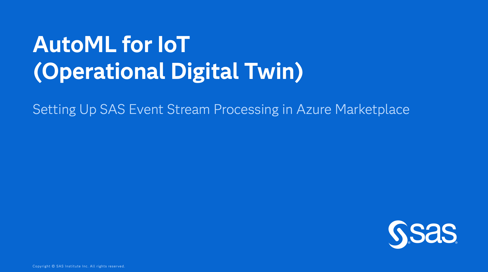
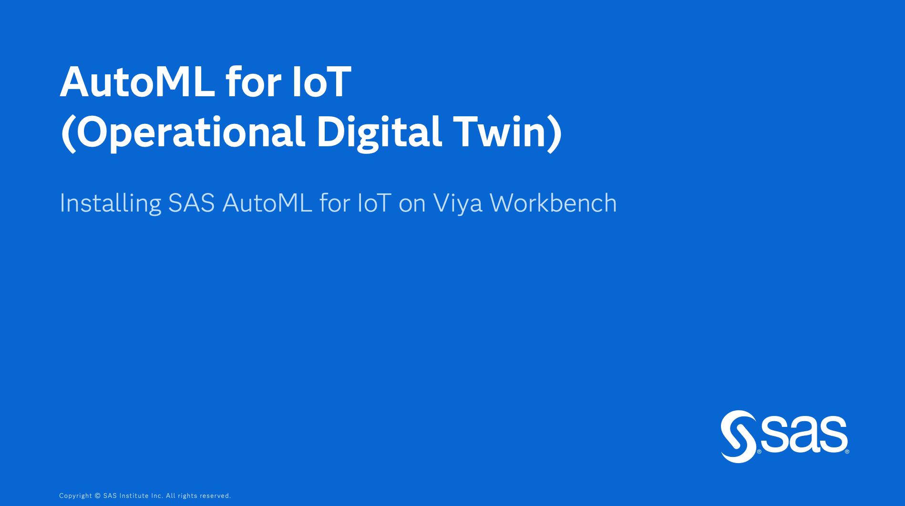

# Installation

Interested in trying SAS AutoML for IoT for yourself?  Here's what you'll need...  Everything is available in the cloud and can be up and running in minutes.

- A SAS Profile - this will provide you access to a trial environment where you can give it a test drive

- SAS Viya ...or... SAS Viya Workbench - Viya is SAS' modern analytics platform that includes a full suite of capabilities, while Viya Workbench is SAS' smaller, low-profile analytics environment that supports SAS and open-source content seemlessly. Both options can be used by SAS AutoML for IoT.

- SAS Event Stream Processing - this is available as part of Viya or can be paired as a stand-alone deployment environment with Viya Workbench. It contains SAS' real-time products - SAS Event Stream Processing and SAS Event Stream Manager. It is where SAS AutoML for IoT will set your final project running live 24/7 to monitor your use case. It is also used to replay historical data as if it were live.

 

 

First, set up your SAS profile...

 

## Setting Up a SAS Profile (5 minutes) 

The below powerpoint will walk you through creating your SAS Profile.

Step-by-Step Guide            | 
:----------------------------:|
 |

 

 

Next... choose to either set up Viya  ..OR..  Viya Workbench...

 

## Setting Up Viya or Viya Workbench (5 minutes)

If you already have a Viya environment, great!  You can skip this step!  If not, use one of the below options to set up a trial environment of either Viya or Viya Workbench.

### Setting Up Viya (5 minutes)

The below powerpoint will walk you through signing up for a 14-day free trial of Viya.

Step-by-Step Guide            | 
:----------------------------:|
 |

 

...or...

 

### Setting Up Viya Workbench (5 minutes)

The below powerpoints will walk you through creating your Viya Workbench environment. If you have a .edu email address, you can obtain a free Viya Workbench for Learners environment. If not, please contact the SAS AutoML for IoT Support Team (<AutoMLforIoT@sas.com>) for trial access to a Viya Workbench Engage environment.

 

#### Viya Workbench for Learners 

Step-by-Step Guide         | 
:-------------------------:|
 |

 

#### Viya Workbench via Engage 

Step-by-Step Guide         | 
:-------------------------:|
 |

**SAS EMPLOYEES** can obtain a Viya Workbench environment for internal or partner use via Engage by following the instructions [here](requesting-a-viya-workbench/README.md).

 

 

Next... if your Viya install does not already contain SAS Event Stream Processing or you are using Viya Workbench, then set up SAS Event Stream Processing...

 

## Setting Up SAS Event Stream Processing (15 minutes) 

The below powerpoint will walk you through creating your SAS Event Stream Processing environment via Azure Marketplace. If you need a trial license, please contact the SAS AutoML for IoT Support Team (<AutoMLforIoT@sas.com>) - this license will be required in the install process.

Step-by-Step Guide         | 
:-------------------------:|
 |

 

 

And finally, install SAS AutoML for IoT...

 

## Installing SAS AutoML for IoT (5 minutes) 

The below powerpoint will walk you through installing SAS AutoML for IoT. Note that you will need to download these three files to complete the installation... \
[Install_SASAutoMLforIoT.sas](installFiles/Install_SASAutoMLforIoT.sas) \
[Update_SASAutoMLforIoT.sas](installFiles/Update_SASAutoMLforIoT.sas) \
[sasmacr.sas7bcat](installFiles/sasmacr.sas7bcat) 

The powerpoint also discusses how to easily update SAS AutoML for IoT as enhancements are made to the codebase.

Step-by-Step Guide for Viya        | Step-by-Step Guide for Viya Workbench |
:---------------------------------:|:---------------------------------:|
 |  |

Copyright © 2026, SAS Institute Inc., Cary, NC, USA.  All Rights Reserved.

 

 

        
