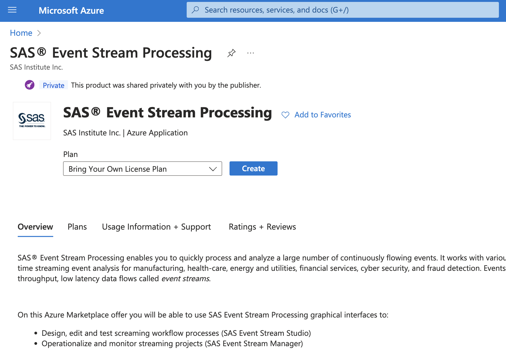
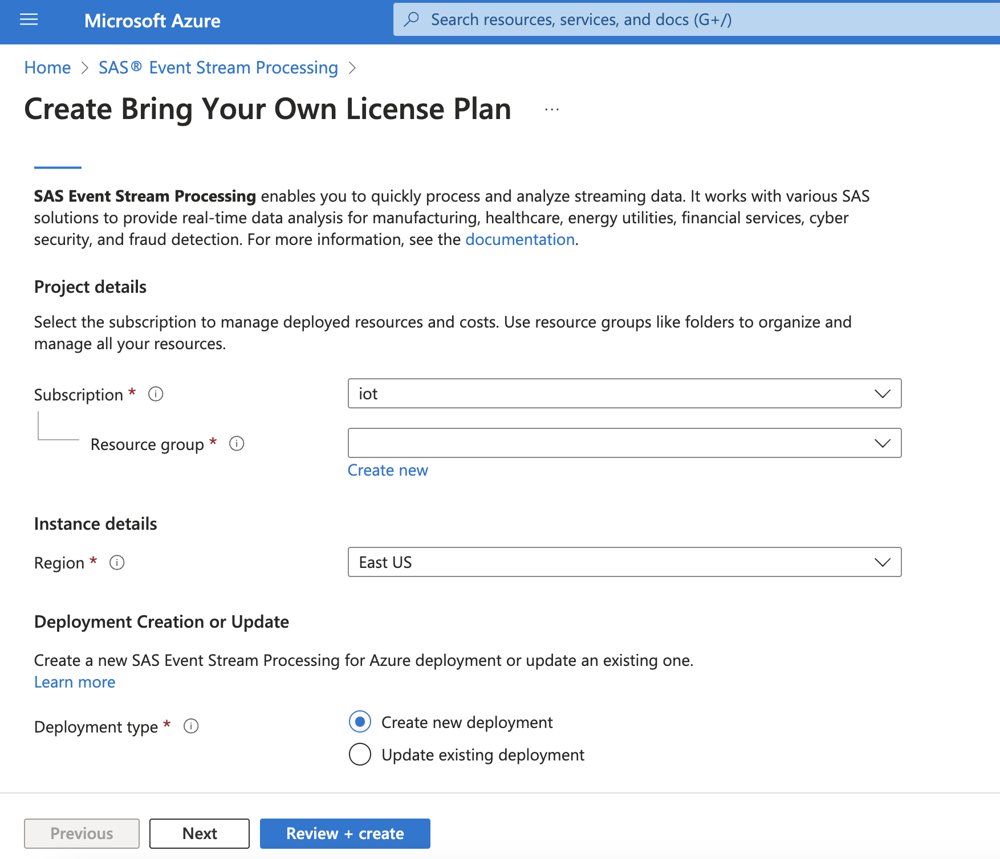
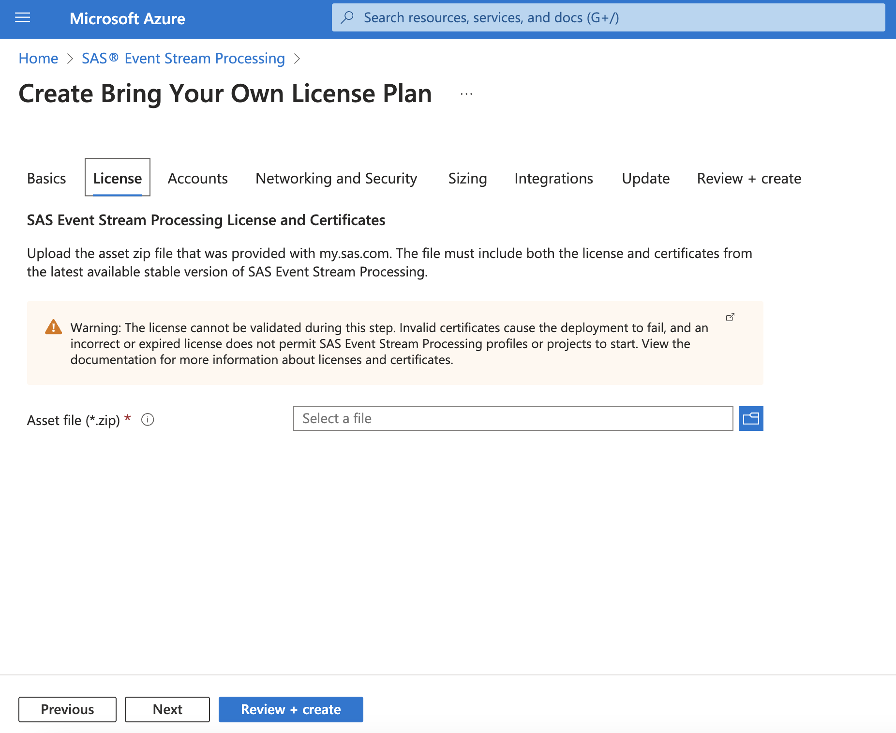
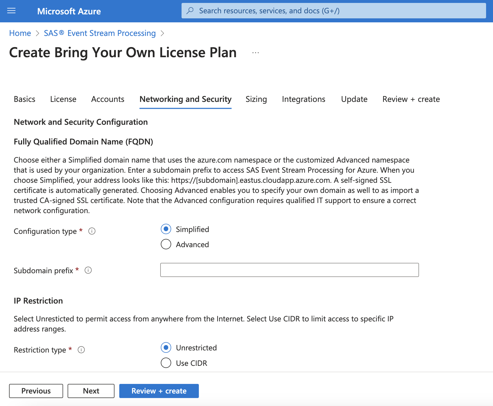
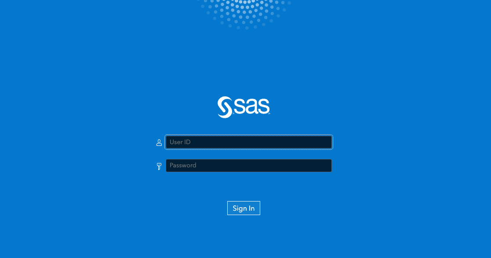

# Set Up SAS Event Stream Processing in Azure

Use this task when SAS Event Stream Processing is not already available in your SAS environment.

This section describes how to deploy a standalone SAS Event Stream Processing environment from Azure Marketplace.

## Create the Azure Deployment

Open the [SAS Event Stream Processing offering](https://portal.azure.com/#view/Microsoft_Azure_Marketplace/GalleryItemDetailsBladeNopdl/id/sas-institute-560503.sas_esp/resourceGroupId//resourceGroupLocation//dontDiscardJourney~/false/_provisioningContext~/%7B%22initialValues%22%3A%7B%22subscriptionIds%22%3A%5B%22360edc48-ce4e-4432-b8a7-7970ecbabfe1%22%2C%220edb07ac-1ded-42c6-8183-50bb3f7416b7%22%5D%2C%22resourceGroupNames%22%3A%5B%5D%2C%22locationNames%22%3A%5B%22eastus%22%5D%7D%2C%22telemetryId%22%3A%22ca3cafdd-f0af-4261-bfe3-31ed2514a11b%22%2C%22marketplaceItem%22%3A%7B%22categoryIds%22%3A%5B%5D%2C%22id%22%3A%22Microsoft.Portal%22%2C%22itemDisplayName%22%3A%22NoMarketplace%22%2C%22products%22%3A%5B%5D%2C%22version%22%3A%22%22%2C%22productsWithNoPricing%22%3A%5B%5D%2C%22publisherDisplayName%22%3A%22Microsoft.Portal%22%2C%22deploymentName%22%3A%22NoMarketplace%22%2C%22launchingContext%22%3A%7B%22telemetryId%22%3A%22ca3cafdd-f0af-4261-bfe3-31ed2514a11b%22%2C%22source%22%3A%5B%5D%2C%22galleryItemId%22%3A%22%22%7D%2C%22deploymentTemplateFileUris%22%3A%7B%7D%2C%22uiMetadata%22%3Anull%7D%7D) in Azure Marketplace.

Choose the **Bring Your Own License Plan** and select **Create**.



Choose or create a resource group, select a region, choose **Create new deployment**, and continue.



## Provide the License

Provide the SAS Event Stream Processing license file required by the deployment.



If a trial license is required, please email the [AutoMLforIoT Support Team](mailto:AutoMLforIoT@sas.com).


## Configure Administrative Accounts

The Azure deployment asks you to create administrative credentials for ESP and PostgreSQL.

Choose user names and passwords for admin accounts – one for ESP and one for the PostgreSQL database.

Make a note of these since you will need them later to log in (or store them using your organization's approved password-management process).


## Configure Networking

Choose the networking settings and a subdomain prefix.

The selected prefix becomes part of the ESP URL, conceptually:

```text
https://<subdomain>.<azure-region>.cloudapp.azure.com
```



Keep a record of the selected hostname so you can configure the environment locally later.

## Choose Sizing and Optional Azure Integrations

Select the desired sizing. Note that the defaults are typically sufficient for an initial setup and that GPU access is not typically required.

Then choose whether the deployment should integrate with Azure Event Hub or Blob Storage.

Review Azure's validation messages and create the deployment.

## Open SAS Event Stream Processing

After deployment completes, open the ESP instance using the hostname created during networking setup.



## Next

Install AutoML for IoT in your analytics environment:

- [Install on SAS Viya](install-viya.md)
- [Install on SAS Viya Workbench](install-viya-workbench.md)
