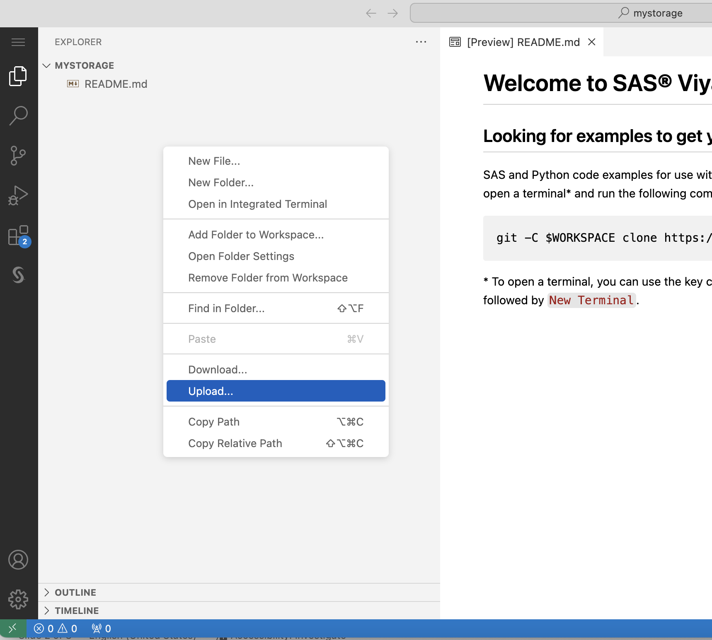
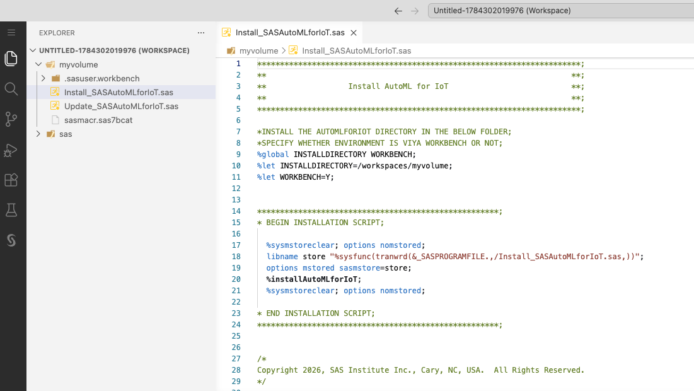
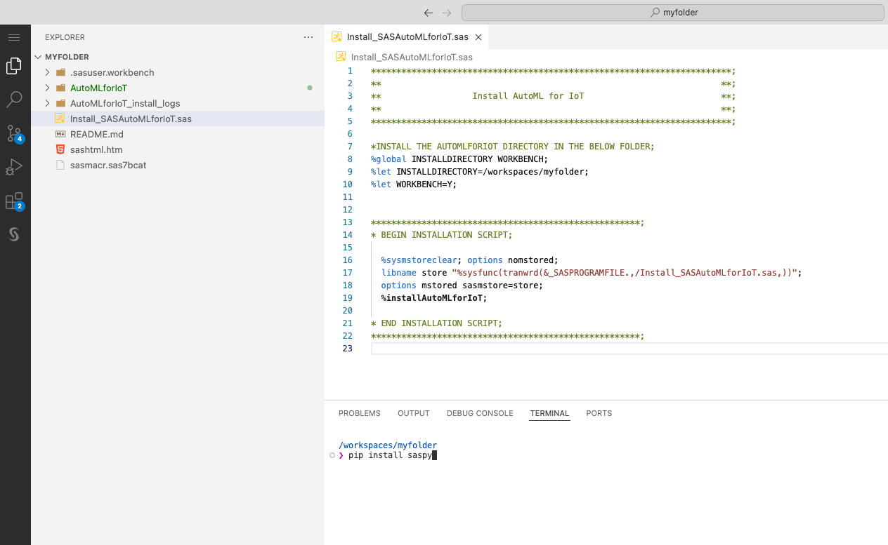
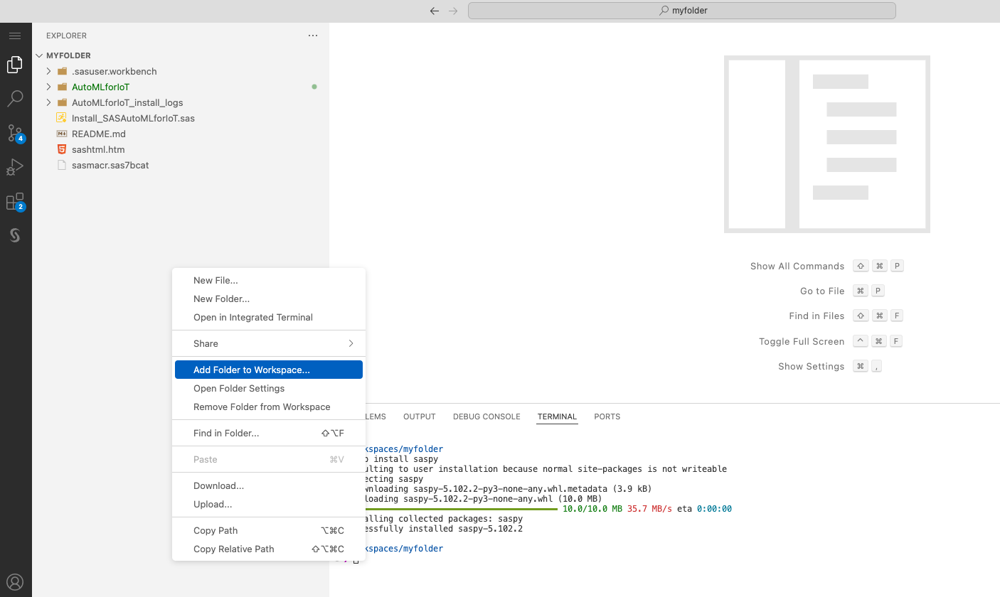
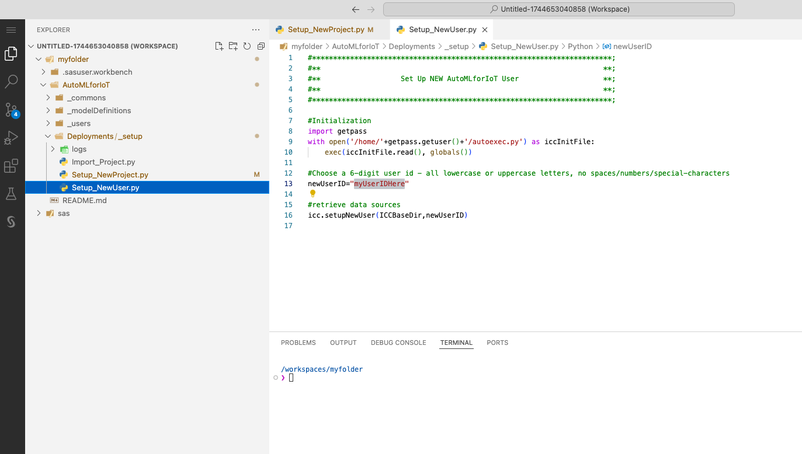
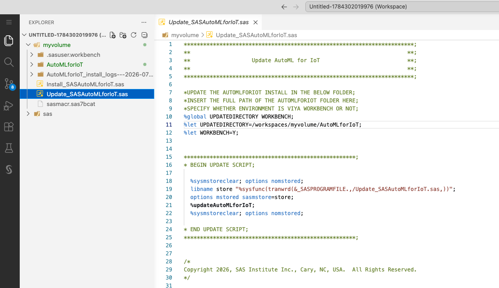

# Install AutoML for IoT on SAS Viya Workbench

Use this procedure when the AutoML for IoT codebase will run in SAS Viya Workbench.

## Prepare the Installation Files

Retain these three repository files:

- [`Install_SASAutoMLforIoT.sas`](installFiles/Install_SASAutoMLforIoT.sas)
- [`Update_SASAutoMLforIoT.sas`](installFiles/Update_SASAutoMLforIoT.sas)
- [`sasmacr.sas7bcat`](installFiles/sasmacr.sas7bcat)

## Upload the Installation Files

In the Workbench Visual Studio Code environment, upload the three installation files.



## Run the Installer

Open:

```text
Install_SASAutoMLforIoT.sas
```

Confirm that the top-level directory in Workbench matches the installation directory configured in the program.

Make sure WORKBENCH is set to Y.

Run the installer.

The `AutoMLforIoT` directory should appear in the workspace.



If installation problems occur, review:

```text
AutoMLforIoT_install_logs
```

## Install `saspy`

Open a terminal and run:

```bash
pip install saspy
```

This enables Python code to invoke SAS functionality.



## Configure the Workbench Autoexec

Add `/home/sas` to the workspace...



Open:

```text
/home/sas/autoexec.py
```

Update the ESP standalone connection information so it matches your ESP environment.

## Set Up a New AutoML for IoT User

AutoML for IoT requires you to assign yourself a user ID. Complete this step once for each AutoML for IoT user.

Open:

```text
/AutoMLforIoT/Deployments/_setup/Setup_NewUser.py
```

Edit the `newUserID` value.

Use a short identifier containing only letters - typically 5–10 characters.

For example:

```text
newUserID = myuser
```

Run `Setup_NewUser.py`.



## Updating AutoML for IoT

When an updated codebase is available, open:

```text
Update_SASAutoMLforIoT.sas
```

Set the update directory to the existing installation, for example:

```text
/workspaces/myfolder/AutoMLforIoT
```

or the actual location used by your Workbench.

Make sure that WORKBENCH is set to Y.

Then run the updater.



## Next

Installation is complete. Register your user and create or import a project in [Setting Up Your First Project](../setting-up-your-first-project/README.md).
