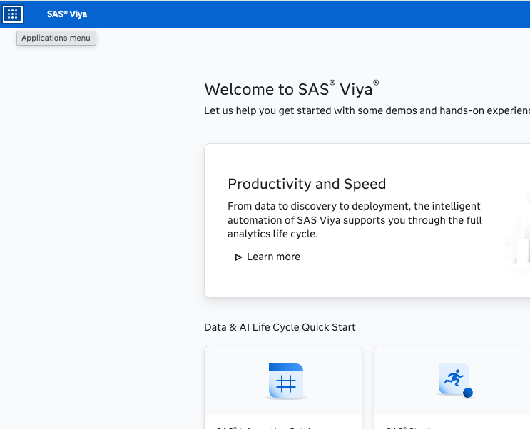
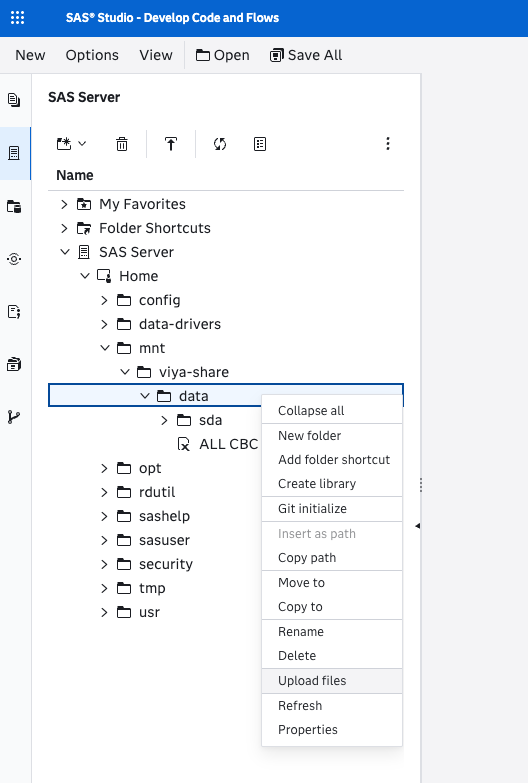
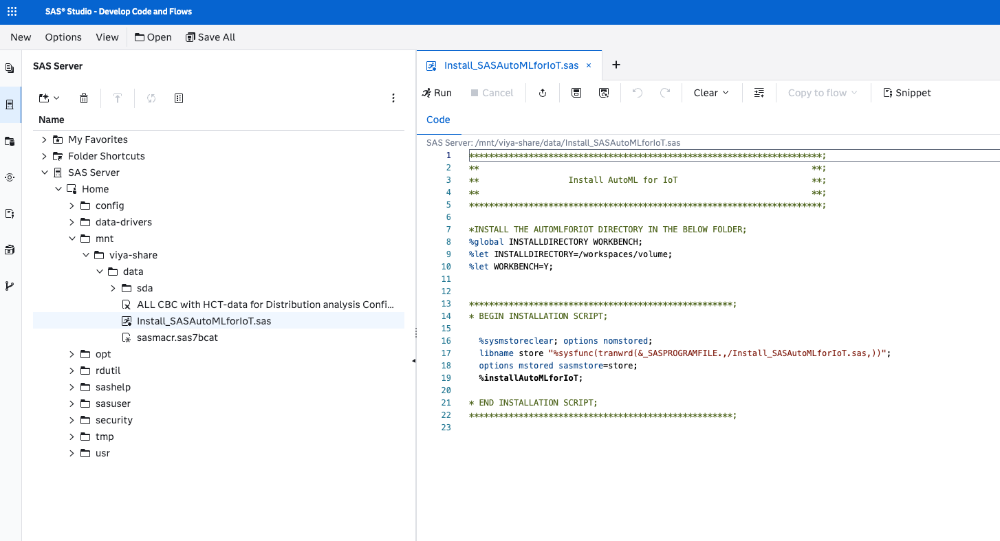
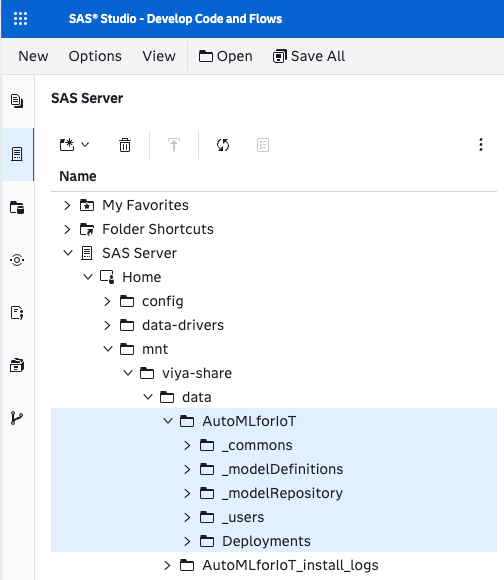
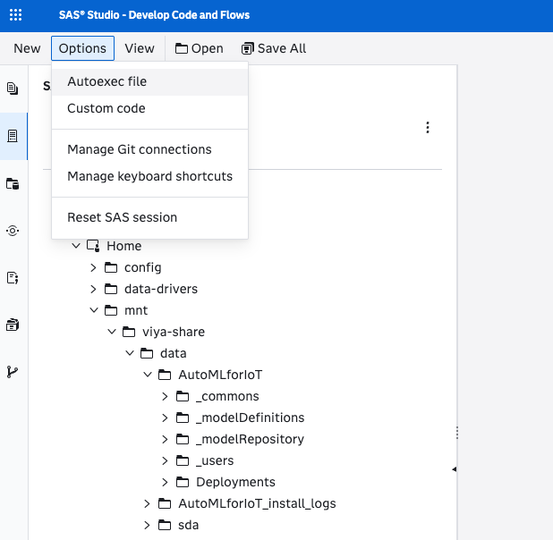
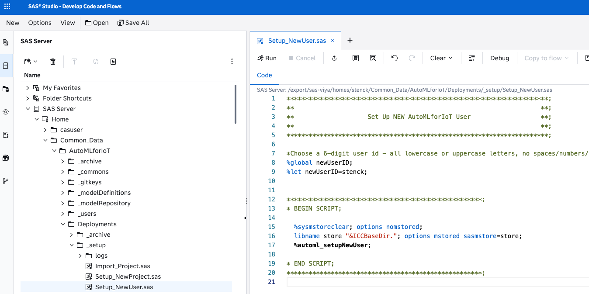
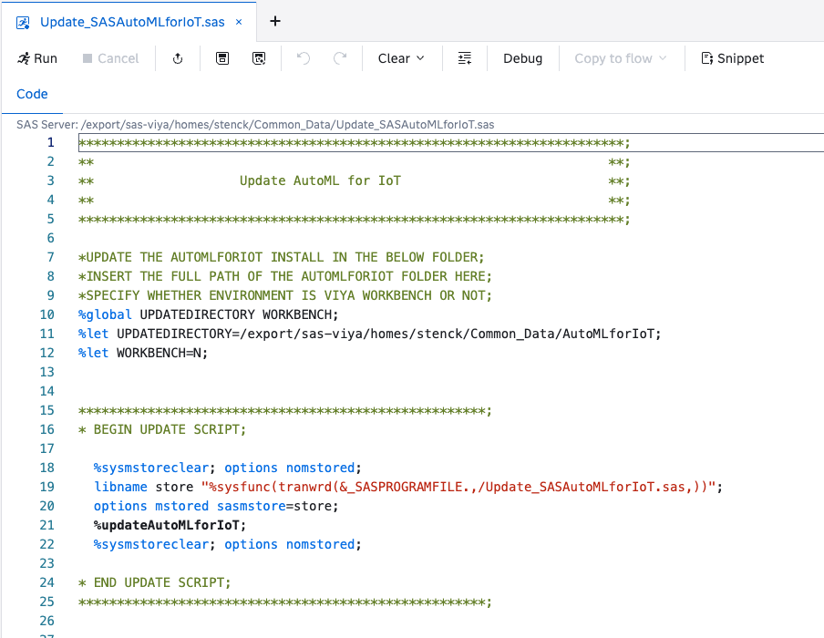

# Install AutoML for IoT on SAS Viya

Use this procedure when the AutoML for IoT codebase will run in SAS Viya.

## Prepare the Installation Files

Download or retain these three repository files:

- [`Install_SASAutoMLforIoT.sas`](installFiles/Install_SASAutoMLforIoT.sas)
- [`Update_SASAutoMLforIoT.sas`](installFiles/Update_SASAutoMLforIoT.sas)
- [`sasmacr.sas7bcat`](installFiles/sasmacr.sas7bcat)

## Open SAS Studio

From SAS Viya, open **Develop Code and Flows** to launch SAS Studio.

Navigate to:

```text
/mnt/viya-share/data
```

or whatever directory you would like to use to install the AutoML for IoT codebase.



## Upload the Installation Files

Upload all three installation files into the selected directory.



## Configure the Installer

Open:

```text
Install_SASAutoMLforIoT.sas
```

Set the installation directory to:

```text
/mnt/viya-share/data
```

or another approved location.

For SAS Viya, set the Workbench indicator to:

```text
N
```



## Run the Installation

Run `Install_SASAutoMLforIoT.sas`.

The `AutoMLforIoT` directory should appear in the file tree.



If installation problems occur, review:

```text
AutoMLforIoT_install_logs
```

## Configure the SAS Autoexec

Open:

```text
/AutoMLforIoT/_commons/autoexec.sas
```

Copy its contents.

In SAS Studio, open **Options** and then **Autoexec file**. Paste the copied code, run it, and save it.



This makes the AutoML for IoT codebase available to later SAS sessions.

## Set Up a New AutoML for IoT User

AutoML for IoT requires you to assign yourself a user ID. Complete this step once for each AutoML for IoT user.

Open:

```text
/AutoMLforIoT/Deployments/_setup/Setup_NewUser.sas
```

Edit the `newUserID` value.

Use a short identifier containing only letters - typically 5–10 characters.

For example:

```text
newUserID = myuser
```

Run `Setup_NewUser.sas`.



## Updating AutoML for IoT

When an updated codebase is available, open:

```text
Update_SASAutoMLforIoT.sas
```

Set the update directory to the existing installation, for example:

```text
/mnt/viya-share/data/AutoMLforIoT
```

and ensure:

```text
WORKBENCH=N
```

Then run the updater.



## Next

Installation is complete. Register your user and create or import a project in [Setting Up Your First Project](../setting-up-your-first-project/README.md).
