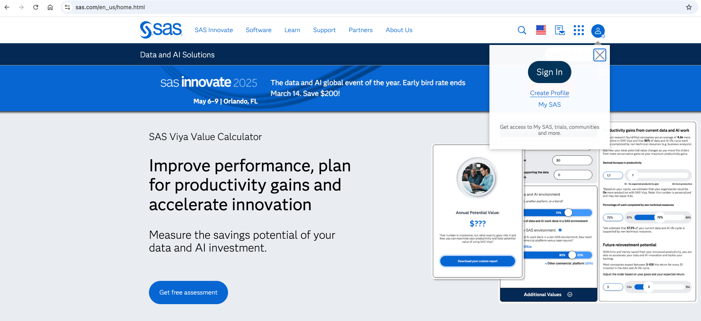
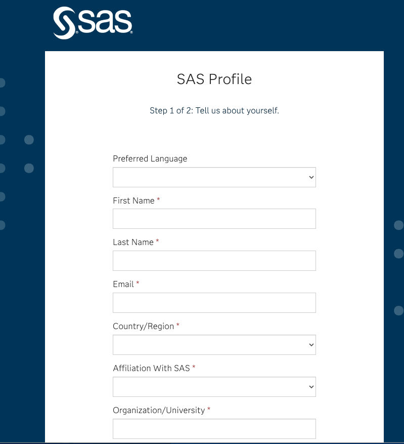
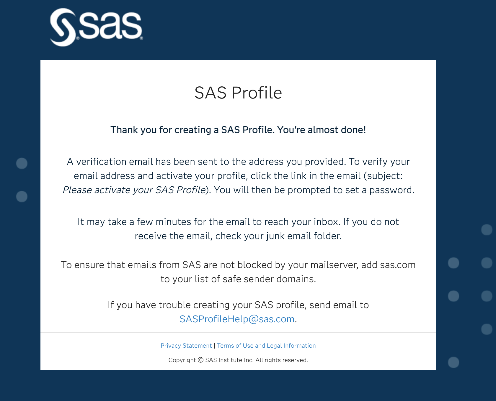
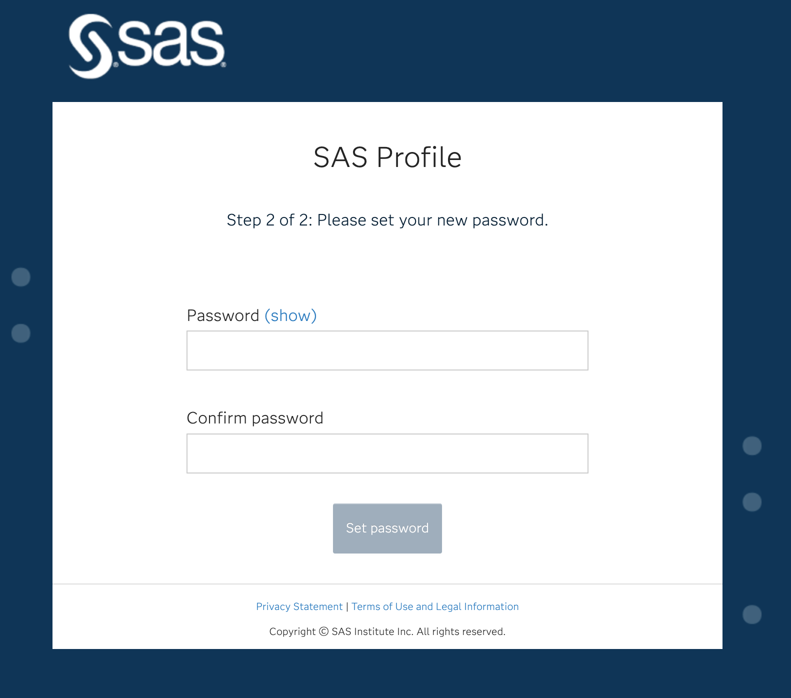

# Create a SAS Profile

Create a SAS Profile if you do not already have one.

The profile is used when accessing SAS trial and learning environments described in the installation workflow.

## Create the Profile

1. Navigate to the [SAS website](https://www.sas.com/en_us/home.html).
2. Select the user/profile icon.
3. Choose **Create Profile**.

Complete the requested profile information and select **Create Profile**.

## Activate the Profile

Typically, you will receive an activation email from replies-disabled@sas.com.

Use the activation link in that email.

Complete activation by choosing a password for the profile.

After submission, the profile should report that it is active.

## Next

Choose the SAS analytics environment you will use:

- [Set Up SAS Viya](viya.md)
- [Set Up SAS Viya Workbench for Learners](viya-workbench-learners.md)
- [Set Up SAS Viya Workbench via Engage](viya-workbench-engage.md)
