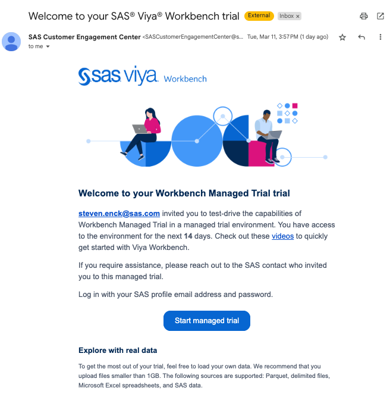
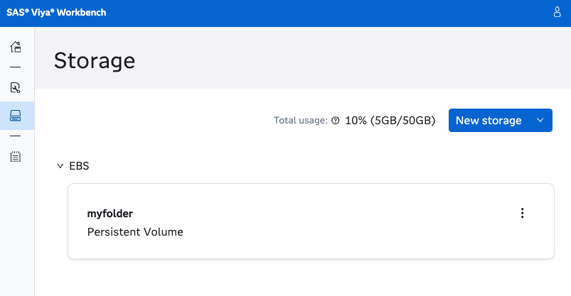
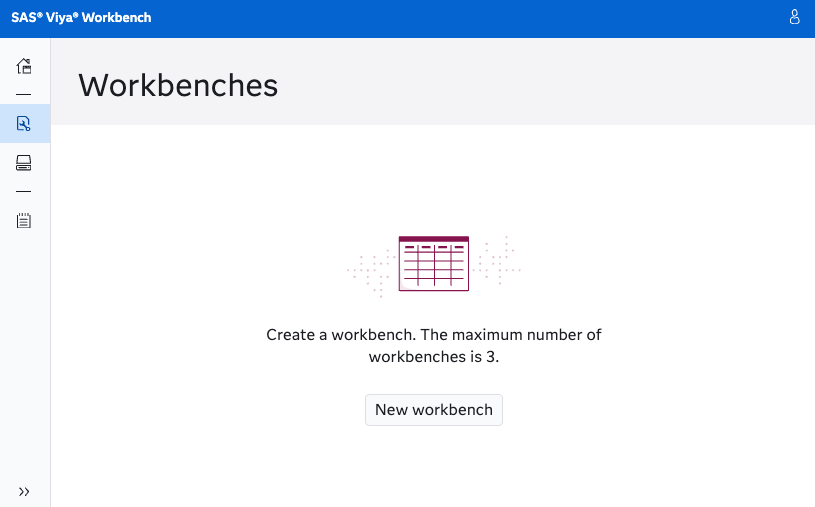
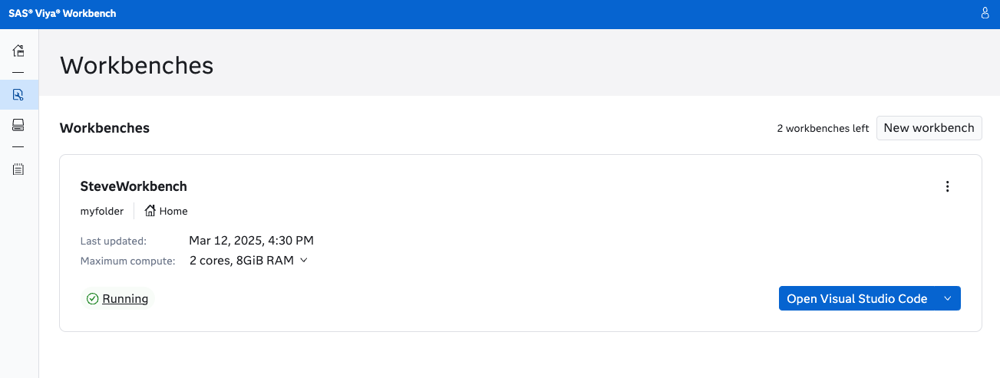

# Set Up SAS Viya Workbench via Engage

Use this path when Viya Workbench access is provided through SAS Engage (initiated by a SAS employee).

## Start the Managed Trial

Typically, you will receive an invitation email from:

```text
SASCustomerEngagementCenter@sas.com
```

Select **Start managed trial**.



Accept the terms and conditions.

## Configure Storage

Before creating a workbench, open **Storage**.



If `myVolume` does not exist (formerly `myfolder`), create it using the source defaults:

```text
Name: myVolume
Storage type: EBS
Size: 5 GB
```

Then create a home storage location using:

```text
Storage type: EFS
Size: 5 GB
```

You should have both `myVolume` and `Home`, with `Home` identified as the home storage location.

## Create the Workbench

Open **Workbenches**, select **New workbench**, edit the name if desired, and leave the compute and storage values at their defaults unless your environment requires otherwise.



Note that the environment can go idle automatically. Select **Start** to resume it.

## Open Visual Studio Code

Select **Open Visual Studio Code**.



## Next

Continue to [Set Up SAS Event Stream Processing in Azure](event-stream-processing-azure.md).
