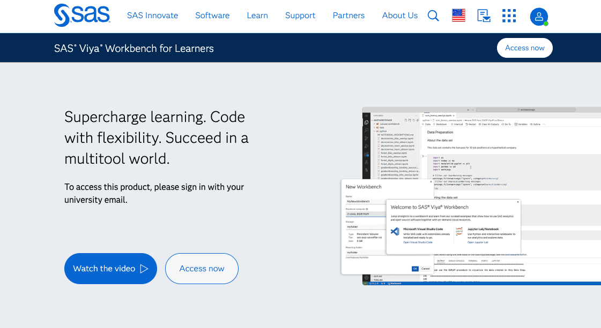
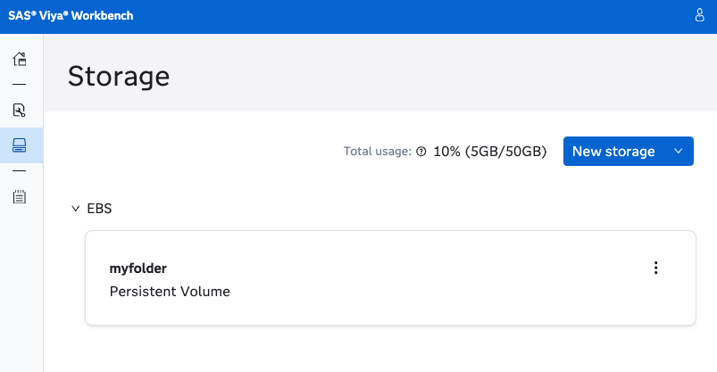
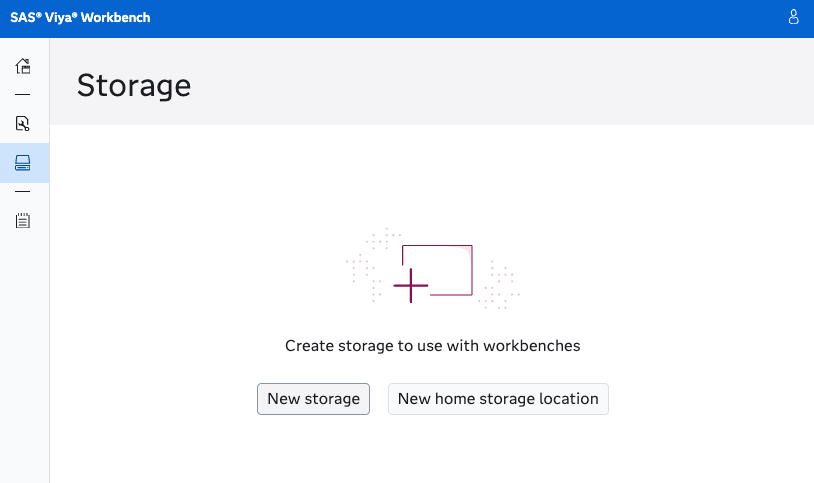
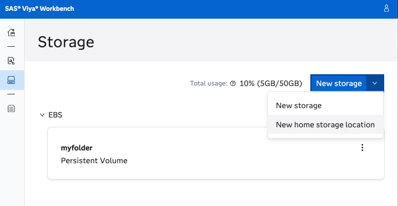
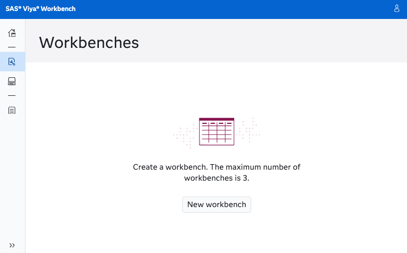
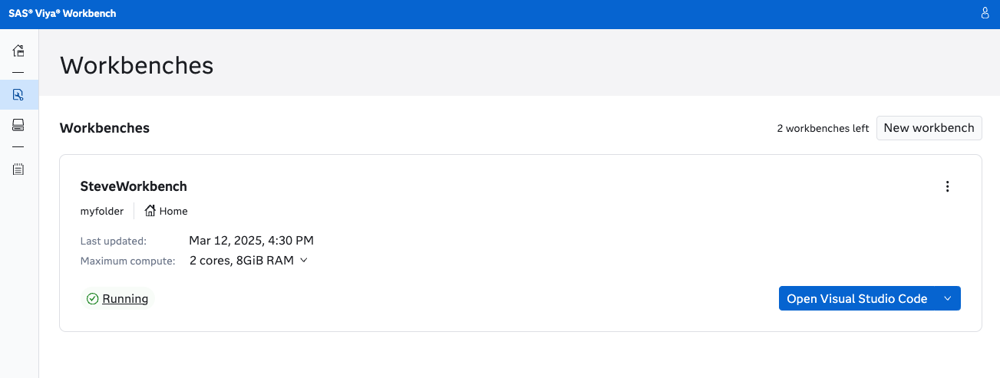

# Set Up SAS Viya Workbench for Learners

Use this path when you have access to SAS Viya Workbench for Learners.

## Access Viya Workbench for Learners

Open the [Viya Workbench for Learners site](https://www.sas.com/en_us/software/viya-workbench-for-learners.html), select **Access now**, and sign in with your SAS Profile if prompted.



Select **Launch Software** and accept the license agreement.

If prompted to sign in again, use the **SAS Viya Workbench for Learners** sign-in option.

## Configure Storage Before Creating a Workbench

Before selecting **New workbench**, open **Storage**.



If `myVolume` does not exist (formerly `myfolder`), create it with:

```text
Name: myVolume
Storage type: EBS
Size: 5 GB
```



Then create a home storage location. Use the defaults:

```text
Storage type: EFS
Size: 5 GB
```



You should then have both `myVolume` and `Home`, with `Home` marked as the home storage location.

## Create the Workbench

Open **Workbenches** and select **New workbench**.

Edit the name if desired and leave the compute and storage settings at their defaults unless your environment requires otherwise.



Note that the environment can go idle automatically to conserve cloud resources. Select **Start** when you need to resume it.

## Open Visual Studio Code

Select **Open Visual Studio Code**.



## Next

Viya Workbench requires SAS Event Stream Processing for the AutoML for IoT real-time and historical-replay workflows. Continue to [Set Up SAS Event Stream Processing in Azure](event-stream-processing-azure.md).
