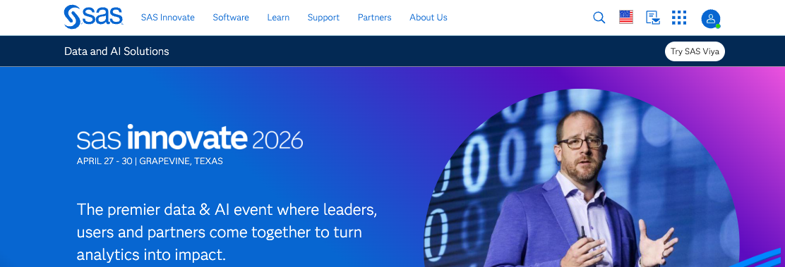
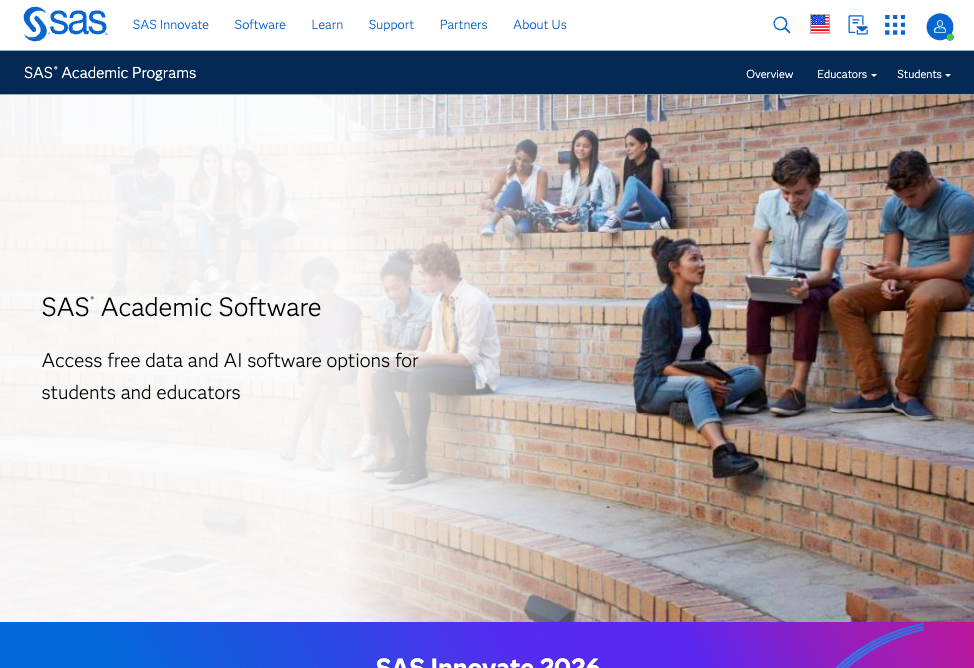
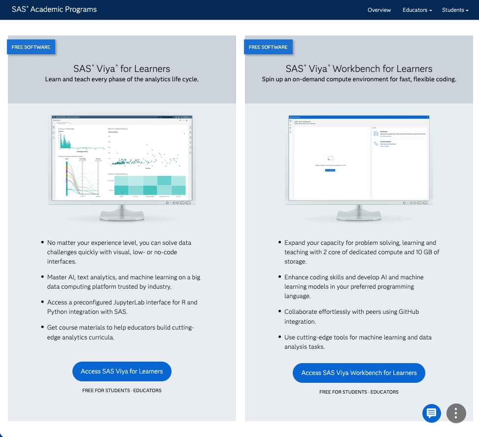
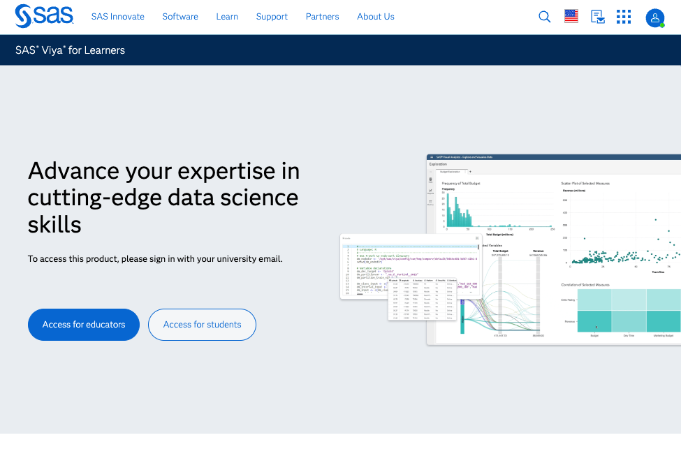
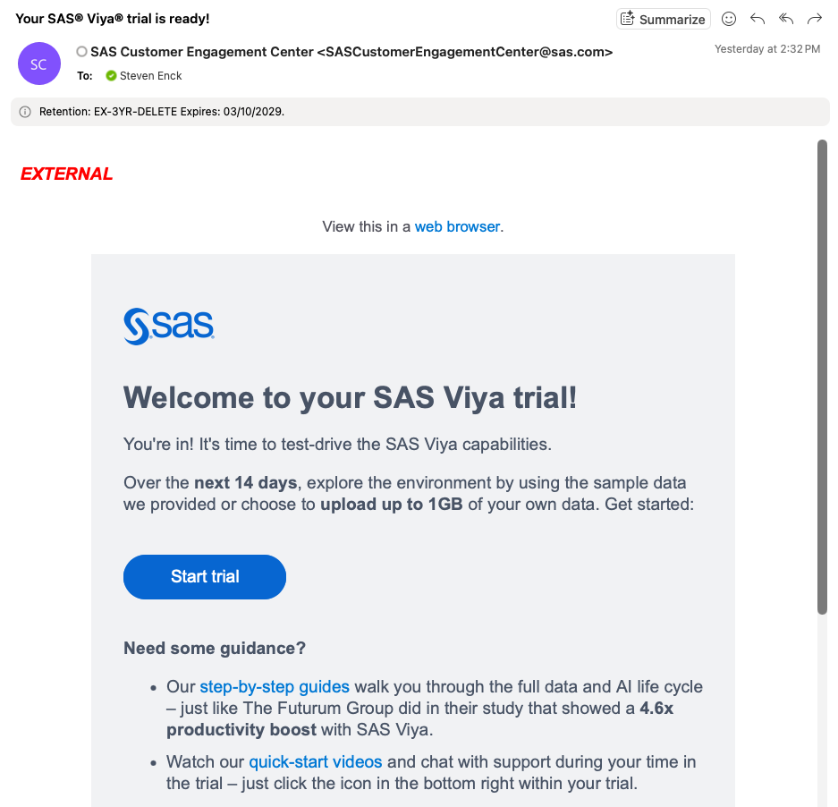
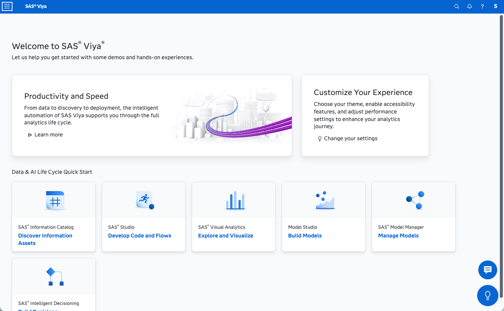

# Set Up SAS Viya

Use this path if you need a SAS Viya environment and do not already have one.

There are two potential paths, depending on whether a corporate trial or academic access is required:

- **Corporate trial**
- **Academic access through SAS Viya for Learners**

You should already have a SAS Profile before beginning. If you do not, see [Create a SAS Profile](sas-profile.md).

## Choose Your Access Path

If you are using a corporate or commercial trial, follow [Corporate Trial](#corporate-trial).

If you are accessing SAS through an academic program, follow [Academic Access](#academic-access).

---

## Corporate Trial

### 1. Sign In with Your SAS Profile

Open the [SAS website](https://www.sas.com/en_us/home.html) and sign in using the SAS Profile you created earlier.

### 2. Start the SAS Viya Trial

Select **Try SAS Viya** at the top right of the screen.

Complete the information requested on the trial form, then select:

```text
Start Free Trial
```



### 3. Follow the Instructions in the Trial Email

After submitting the request, follow the instructions provided in the resulting email to complete setup.

### 4. Open the Environment

When the Viya environment is ready, you will receive an email notification.

Select **Start Trial** to open the environment.


You can bookmark the landing page so it is easier to return to the environment later.

---

## Academic Access

Use this path if you are obtaining SAS Viya through the SAS academic program.

### Before You Begin

Make sure that:

- you have an active SAS Profile
- you can sign in to the SAS website
- you are using the academic access path appropriate to your institution or educator status

The screens presented after selecting academic access can vary as SAS updates the program. Follow the current on-screen eligibility and enrollment instructions.

### 1. Open the SAS Academic Software Page

Navigate to the [SAS academic software area](https://www.sas.com/en_us/learn/academic-programs/software.html).

From that page, locate the option for:

```text
Access SAS Viya for Learners
```



### 2. Select SAS Viya for Learners

Choose:

```text
Access SAS Viya for Learners
```

This moves you into the academic access workflow for the Viya environment.



### 3. Select the Educator Access Path

Academic users should select:

```text
Access for Educators
```



Follow the instructions presented by SAS to request or activate the academic environment.

### 4. Complete the Academic Access Process

Continue through the academic access workflow until SAS confirms that your request or environment setup has been submitted.

At this point, provisioning can occur separately from the browser session, so the environment might not be immediately available.

### 5. Watch for the Environment-Ready Email

You will typically receive an email when the SAS Viya environment is ready.



Use the link or button provided in that message to return to your environment.

### 6. Start SAS Viya

Select:

```text
Start Trial
```

or the equivalent launch control presented in the environment-ready message or landing page.



This opens the Viya environment that you will use for AutoML for IoT.

### 7. Bookmark the Landing Page

After the environment opens successfully, bookmark the landing page.

This gives you a convenient starting point when you return to SAS Viya for later AutoML for IoT work.

---

## Confirm You Are Ready to Continue

Before moving on, confirm that you can:

- sign in with your SAS Profile
- open your SAS Viya environment
- reach the Viya landing page successfully

You do not need to configure an AutoML for IoT project yet. That occurs after the AutoML for IoT codebase is installed.

## Next

If SAS Event Stream Processing is already available in your Viya environment, continue to [Install AutoML for IoT on SAS Viya](install-viya.md) or [Install AutoML for IoT on SAS Viya Workbench](install-viya-workbench.md).

If Event Stream Processing is not available, first [set up a standalone SAS Event Stream Processing environment](event-stream-processing-azure.md).
