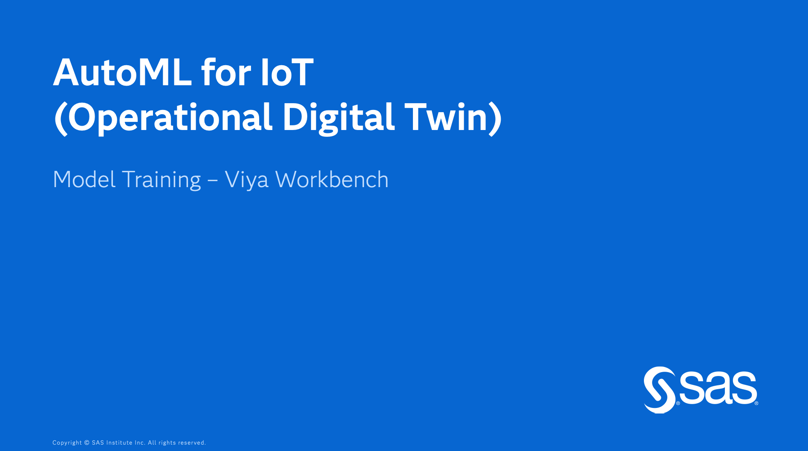
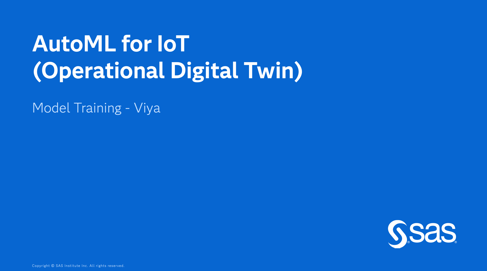

# Model Training

Now that you've retrieved your analytic datasets from the historical replay, you are ready to kick off model training (if applicable).

Since you specified the models you wanted to train earlier, this part of the process is entirely automated. You just need to initiate the process and watch it run!

The below powerpoint will show you how to instruct SAS AutoML for IoT to initiate model training. Note that seperate powerpoints are provided for both Viya and Viya Workbench, as this step is different depending on which environment you are working on.

Step-by-Step Guide for Viya        | Step-by-Step Guide for Viya Workbench        |
:-------------------------:|:-------------------------:|

 |  |

      