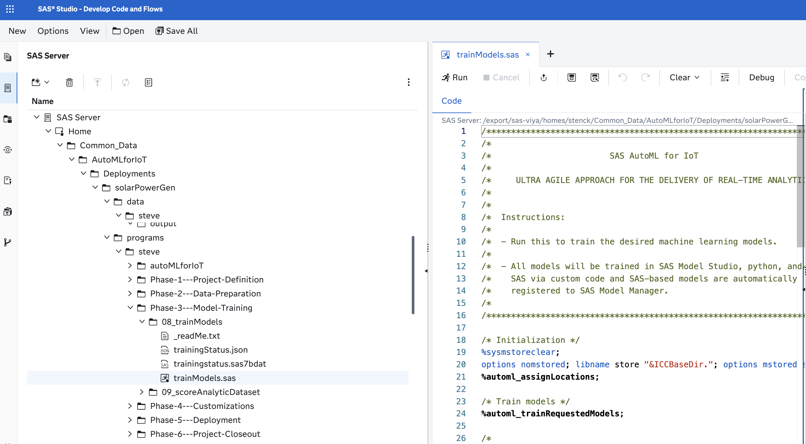
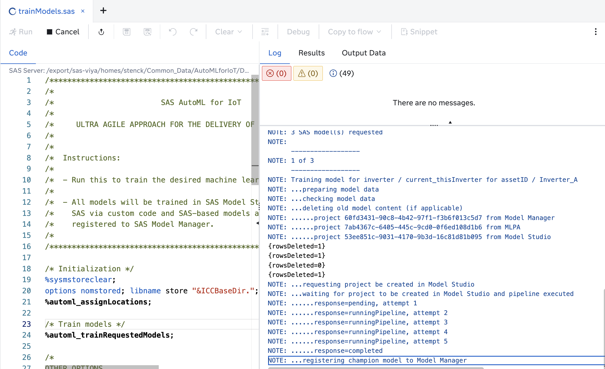
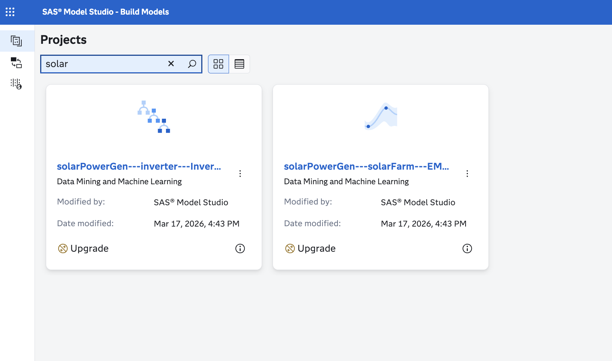
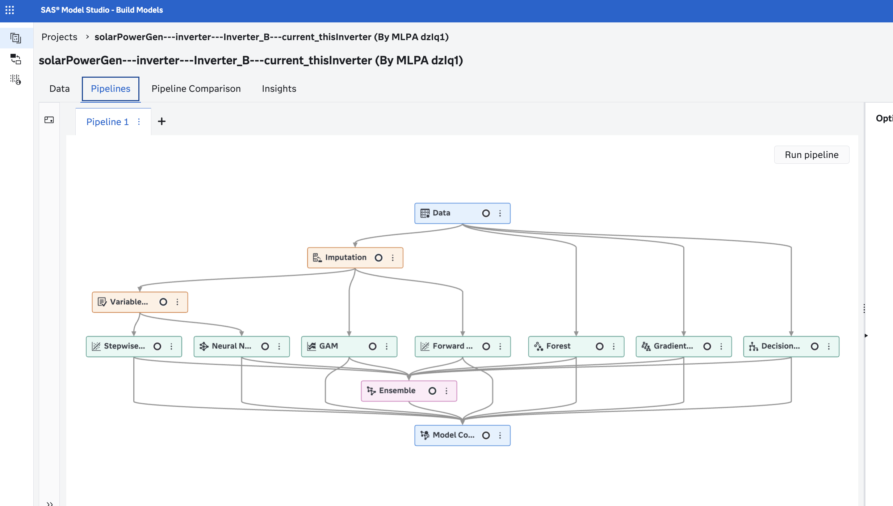
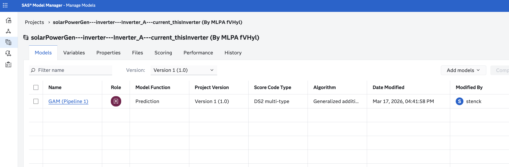

# Train Models in SAS Viya

Use this procedure when the AutoML for IoT project is running in SAS Viya.

The training process uses the model definitions created earlier and the analytic datasets generated from historical replay.

This step is fully automated: running the training program executes the instructions already provided in the model definitions. To review or change the target, predictors, grouping approach, pipeline, or training period, see [Specify Models to Train and Deploy](../designing-output-tables-and-models/models.md).

## Run `trainModels.sas`

Open and run:

```text
08_trainModels/trainModels.sas
```



If the optional parameters are left blank, the program trains all models requested by the model definitions.

## Optional Parameters

Three optional parameters can limit the training run.


### `subsetAssetType`

Use `subsetAssetType` to train models for only one target asset type.

This is useful when the model definitions contain targets for several asset types but only one asset type needs to be retrained.

### `subsetAttributeID`

Use `subsetAttributeID` to train models for only one target attribute ID.

This is useful when several model targets are defined but only one target needs to be trained or retrained.

### `subsetSplitID`

Use `subsetSplitID` to train only one model group.

The meaning of the split ID depends on the model-grouping strategy:

| Model grouping | `subsetSplitID` value |
|---|---|
| One Model Per AssetID | Enter the target `assetID` |
| One Model Applicable to All Assets | Enter the target `assetType` |
| One Model Per Unique AttributeID Value | Enter the grouping attribute value |

For example, if models are trained separately for each string asset, entering one string's `assetID` limits training to that asset's model.

## Monitor Training Progress

As training runs, progress information is written to the SAS log.



Review the log for completion status and any errors that need to be resolved.
 
## Where the Trained Model Is Stored

The result depends on the type of pipeline specified in the model definition.

### SAS Model Studio Pipeline

SAS Model Studio pipelines are trained in **SAS Model Studio**, where the executed pipeline and results can be reviewed.





The resulting model is managed in **SAS Model Manager**.



### Custom SAS Model Pipeline

Custom SAS pipelines train the model in code and store the model content in:

```text
AutoMLforIoT/_modelRepository/sas
```

When training occurs on SAS Viya, the resulting custom SAS model is also registered in **SAS Model Manager**.

### Python Model Pipeline

Python pipelines store the trained model as a `.pkl` file in:

```text
AutoMLforIoT/_modelRepository/python
```

The local repository structure is shown on the [Model Training](README.md) page.


## What Happens Next

After the requested models have been trained, the next phase integrates the trained models into the project.

You can then replay historical analytic data to evaluate how the trained models would have scored during that historical period.

## Previous

For the analytic datasets used as model-training inputs, see [Creating Analytic Datasets](../creating-analytic-datasets/README.md).

## Alternative Environment

If the project is running in SAS Viya Workbench instead of SAS Viya, see [Train Models in SAS Viya Workbench](train-models-workbench.md).

## Next

After training completes, continue to [Scoring the Analytic Dataset](../scoring-the-analytic-dataset/README.md).
