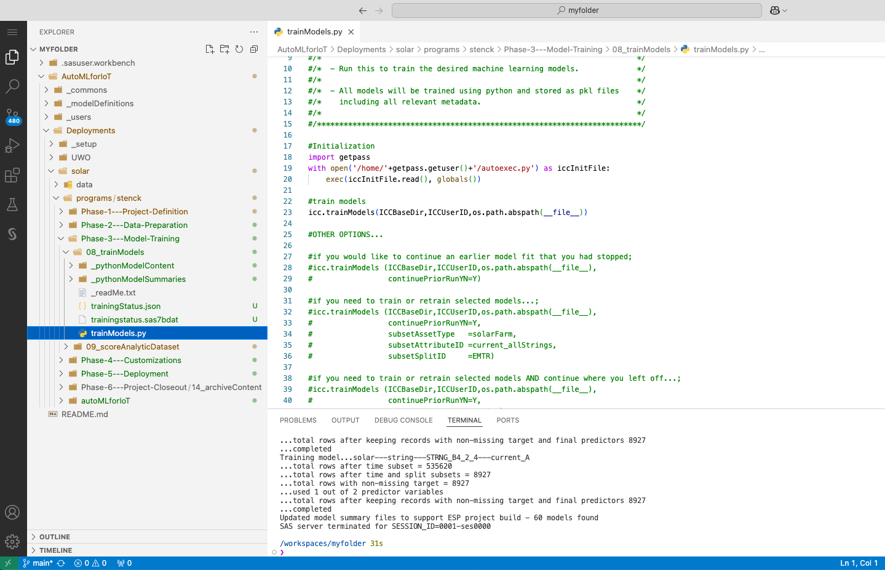
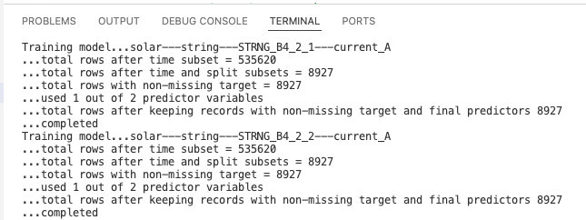

# Train Models in SAS Viya Workbench

Use this procedure when the AutoML for IoT project is running in SAS Viya Workbench.

The training process uses the model definitions created earlier and the analytic datasets generated from historical replay.

This step is fully automated: running the training program executes the instructions already provided in the model definitions. To review or change the target, predictors, grouping approach, pipeline, or training period, see [Specify Models to Train and Deploy](../designing-output-tables-and-models/models.md).

## Run `trainModels`

Open and run the `trainModels` program in:

```text
08_trainModels
```



If the optional parameters are left blank, the program trains all requested models.

## Optional Parameters

Three optional parameters can limit the training run.


### `subsetAssetType`

Use this parameter to train only models whose target is associated with one asset type.

### `subsetAttributeID`

Use this parameter to train only models for one target attribute ID.

### `subsetSplitID`

Use this parameter to train only one model group.

The split ID depends on the model-grouping strategy:

| Model grouping | `subsetSplitID` value |
|---|---|
| One Model Per AssetID | Enter an `assetID` |
| One Model Applicable to All Assets | Enter the `assetType` |
| One Model Per Unique AttributeID Value | Enter the grouping attribute value |

If no subset is specified, the full requested model set is trained.

## Monitor Training Progress

As model training runs, progress messages appear in the log.



Use those messages to track which models have completed and identify any failures.

## Where the Trained Model Is Stored

The result depends on the type of pipeline specified in the model definition.

### Custom SAS Model Pipeline

Custom SAS pipelines train the model in code and store the model content in:

```text
AutoMLforIoT/_modelRepository/sas
```

### Python Model Pipeline

Python pipelines store trained models as `.pkl` files in:

```text
AutoMLforIoT/_modelRepository/python
```

Each Python pickle file contains the trained model and metadata associated with that model.


## Model Metadata in the Pickle File

Note that a stored model pickle can contain metadata including:

- project name
- asset type
- split variable and split ID
- asset list
- target variable
- input-variable list
- scoring-variable mappings
- pipeline ID
- training start and end dates
- data-frame schema
- output information
- champion-model type
- assessment criteria and score
- training sample size
- supporting information
- required packages
- initialization and processing code
- training user and training timestamp
- model ID

This metadata supports downstream scoring and integration of the trained model into the AutoML for IoT project.

## Optional: Inspect a Pickle File

A user can inspect a stored model file using standard approaches as shown below...

For example:

```python
import pickle

with open("myModelPickleFile.pkl", "rb") as f:
    loaded_model_pickle = pickle.load(f)

projectName = loaded_model_pickle["projectName"]
assetType = loaded_model_pickle["assetType"]
targetVar = loaded_model_pickle["targetVar"]
pipelineID = loaded_model_pickle["pipelineID"]
assessmentScore = loaded_model_pickle["assessmentScore"]
model = loaded_model_pickle["model"]
```

This inspection is optional. The normal AutoML for IoT workflow uses the trained model artifacts automatically in the later integration and scoring steps.

## What Happens Next

After the requested models have been trained, the next phase integrates those models into the project.

You can then replay historical analytic data to evaluate how the trained models would have scored during that historical period.

## Previous

For the analytic datasets used as model-training inputs, see [Creating Analytic Datasets](../creating-analytic-datasets/README.md).

## Alternative Environment

If the project is running in SAS Viya instead of SAS Viya Workbench, see [Train Models in SAS Viya](train-models-viya.md).

## Next

After training completes, continue to [Scoring the Analytic Dataset](../scoring-the-analytic-dataset/README.md).
