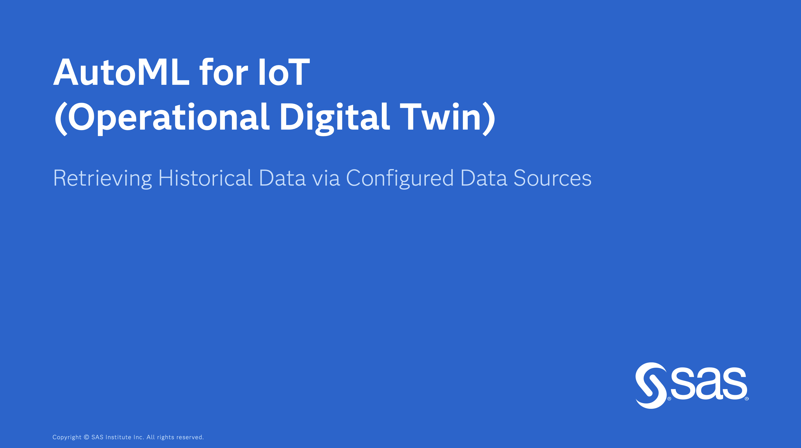
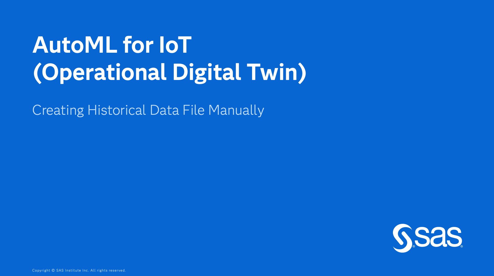

# Retrieving Historical Data

In order to train analytical models, it is necessary to replay historical data for some time period. One of the unique features of AutoML for IoT is that it can replay historical data as if it were live - so generating a historical analytic-ready dataset for training is a snap.

Please choose one of the options below...

- [I set up a database connection or connection to ClearBlade earlier](#retrieving-historical-data-from-an-existing-data-source) - If you set up a database connection in the data sources section earlier - or you configured a connection to ClearBlasde - then you already have the historical data you'll need. SAS AutoML for IoT can retrieve the necessary data in just a few minutes. 

- [I need to create my historical data file manually](#creating-the-historical-data-file-manually) - It is easy to set up a historical data file - there are just a few columns to populate - and the instructions will provide everything you need to know. 

## Retrieving Historical Data from an Existing Data Source

Click on the powerpoint below to see how to retrieve the necessary historical data via your configured data source(s). 

Step-by-Step Guide         |  
:-------------------------:|
 |

## Creating the Historical Data File Manually

The below powerpoint will walk you through the process of creating the historical raw data file manually.

Step-by-Step Guide         |  
:-------------------------:|
 |

      
