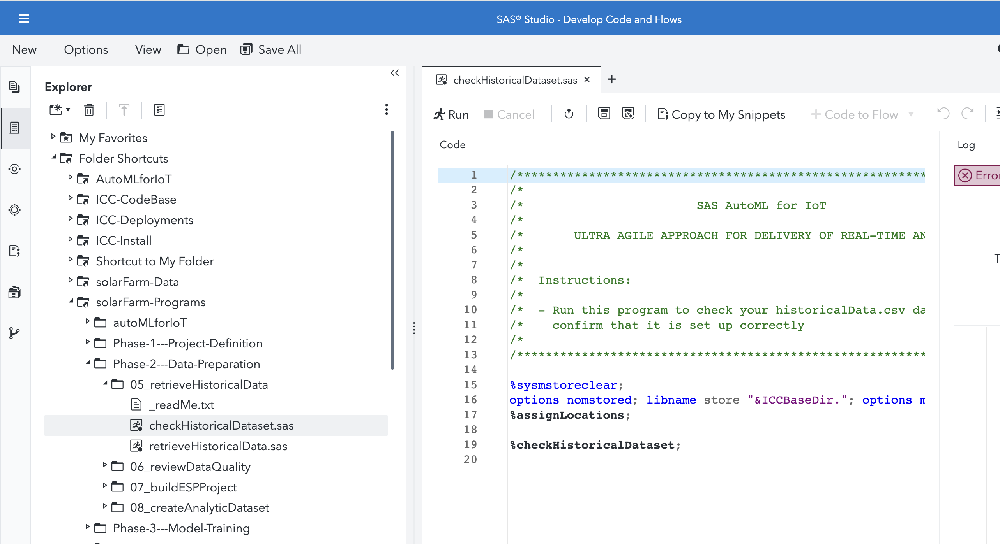

# Create the Historical Data File Manually

Create `historicalData.csv` manually when the historical measurements are not being retrieved through a configured historical database or ClearBlade source.

Store the file at:

```text
<projectName>/data/input/historicalData.csv
```

## The Basic Idea

At its core, `historicalData.csv` is simply a chronological list of individual sensor updates.

Each row represents **one update to one sensor value** in the digital twin.

An example set of historical data records is as follows:

```csv
I,N,1,data,1714492800000000,STR1,current_A,7.8
I,N,1,data,1714492800000000,STR2,current_A,8.1
I,N,1,data,1714492800000000,CBX1,CMBX_temperature_C,31.2
I,N,1,data,1714492860000000,STR1,current_A,7.9
I,N,1,data,1714492860000000,STR2,current_A,8.2
I,N,1,data,1714492860000000,CBX1,CMBX_temperature_C,31.4
```

The first 4 fields are fixed ESP constructs, with the remaining 4 fields being:

```text
timestamp
assetID
attributeID
value
```

Therefore, the first records above means that:

> At UTC timestamp `1714492800000000` (Tue Apr 30 2024 16:00:00.000), the `current_A` attribute for asset `STR1` was updated to `7.8`.

AutoML for IoT replays these rows in timestamp order so the digital twin changes in the same sequence as if the measurements had arrived live.

### Standard Field Definitions

Each standard row contains the following eight fields:

| Position | Field | Description |
|---:|---|---|
| 1 | `opcode` | ESP event-processing construct. Use `"I"` to denote the record as an **insert** event. |
| 2 | `flag` | ESP event-processing construct. Use `"N"` to denote the record as a **new** record. |
| 3 | `index` | Required ESP key field. AutoML for IoT is configured to assign the key automatically, so this field can be populated with any number. The examples use `1`. |
| 4 | `category` | Use `"data"` for a normal sensor update. Other options will be discussed later. |
| 5 | `timestamp` | UTC epoch time in microseconds. |
| 6 | `assetID` | Asset whose value is being updated. |
| 7 | `attributeID` | Raw attribute being updated. |
| 8 | `value` | New value for the attribute. |

The CSV has **no header row** and the records are sorted in **nondecreasing timestamp order**. Multiple records can have the same timestamp.

A typical file contains updates for many assets and attributes over multiple time periods.

### Timestamp Format

The `timestamp` field is UTC epoch time in **microseconds since January 1, 1970**.

For example:

```text
1714492800000000
```

A useful reference for understanding Unix/UTC epoch timestamps is:

https://currentmillis.com/

That site displays epoch time in **milliseconds**, while AutoML for IoT expects **microseconds**.

To convert milliseconds to microseconds, multiply by:

```text
1000
```

For example:

```text
1714492800000 milliseconds
```

becomes:

```text
1714492800000000 microseconds
```


### Asset and Attribute References

For each `data` row:

- `assetID` should identify an asset in the project
- `attributeID` should identify a raw attribute
- `value` should be compatible with that attribute's configured data type

## Dynamic Digital Twin Historical Data

For some use cases, the list of assets and/or the connections between assets may be allowed to change dynamically over time. In such case, the user should first ensure that the project information config has been set to allow the structure of the digital twin to change dynamically while it runs:

```text
allowDynamicChangesToTwin = "Y"
```

In addition to normal sensor updates, the historical file can then replay:

- asset additions, deletions, or updates
- connection additions, deletions, or updates

When a project uses the dynamic digital twin capabilities, historical data rows use an expanded set of 18 fields to capture the required changes to data values, assets, and connections. Fields that do not apply to a row are left blank.

### Expanded 18-Field Structure

The expanded set of fields required when using a dynamic digital twin are: (note that the first 8 are the same as before, with fields 9-13 used to update the assets and fields 14-18 used to update the connections between assets)

```text
opcode
flag
index
category
timestamp
assetID
attributeID
value
updateAssetAction
updateAssetID
updateAssetType
updateAssetLabel
updateAssetOutputRequired
updateConnectionAction
updateHierarchyName
updateParentAssetID
updateDirection
updateChildAssetID
```

### Categories

Use:

```text
category = "data"
```

for a normal sensor update (same as before).

Use:

```text
category = "updateAssets"
```

to add, delete, or update an asset (NEW!). 

Use:

```text
category = "updateConnections"
```

to add, delete, or update a connection (NEW!).

### Asset-Update Fields

For `category = "updateAssets"`, populate:

| Field | Description |
|---|---|
| `updateAssetAction` | `"add"`, `"delete"`, or `"update"` |
| `updateAssetID` | Asset being changed |
| `updateAssetType` | Asset type |
| `updateAssetLabel` | Asset label |
| `updateAssetOutputRequired` | `"Y"` or `"N"` - generally when assets are added, this is set to `"Y"` to ensure that information for the asset is output - however, users can set to `"N"` to have information about the asset tracked but the asset itself excluded from output tables. |

### Connection-Update Fields

For `category = "updateConnections"`, populate:

| Field | Description |
|---|---|
| `updateConnectionAction` | `"add"`, `"delete"`, or `"update"` |
| `updateHierarchyName` | Hierarchy being changed |
| `updateParentAssetID` | Parent asset |
| `updateDirection` | `"-->"`, `"<--"`, or `"<->"` - this controls whether assets can navigate in one or both directions to obtain relevant information. Generally, this field is set to `"<->"` |
| `updateChildAssetID` | Child asset |

### Dynamic Example

When the strucutre of the digital twin is dynamic, the CSV can contain sensor updates and structural changes intermixed in a single csv dataset, as shown below

```csv
I,N,1,data,1672530600000000,BED1,bloodPressure,122,,,,,,,,,,
I,N,1,updateAssets,1672530700000000,,,,add,P100,patient,Patient 100,Y,,,,,
I,N,1,updateConnections,1672530800000000,,,,,,,,,add,hospitalPatient,HOSP1,<->,P100
I,N,1,data,1672530900000000,P100,heartRate,78,,,,,,,,,,
```

This example is still sorted in timestamp order. However, now data records are intermixed with a record that adds a patient asset and connects the patient to a hospital bed. As shown in this example, AutoML for IoT can replay both the sensor values and the changing digital-twin structure in the same sequence in which they would have occurred live.

## Validate the Historical Dataset

After retrieval, run:

```text
checkHistoricalDataset
```

The validation program checks the integrity of the historical records and reports errors in the log.



Before continuing, confirm that:

- the file is named `historicalData.csv`
- the file has no header row
- timestamps are UTC epoch microseconds
- records are sorted in nondecreasing timestamp order
- normal `data` records identify valid project assets and raw attributes
- values are compatible with their attribute data types
- standard files use the eight-field structure
- if asset or connection update records are present, every row uses all 18 field positions
- dynamic-update actions and hierarchy/asset references use valid project values

## Next

After `historicalData.csv` is complete and passes validation, continue to [Reviewing Data Quality](../reviewing-data-quality/README.md).
