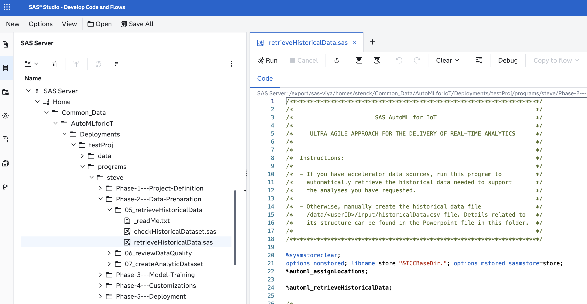
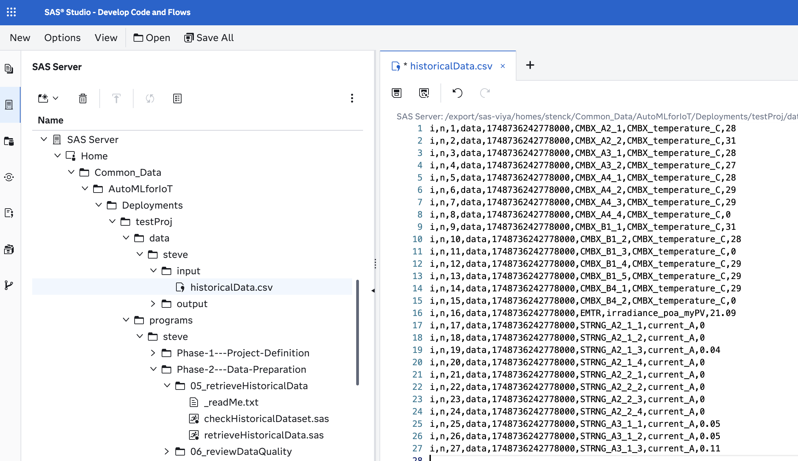
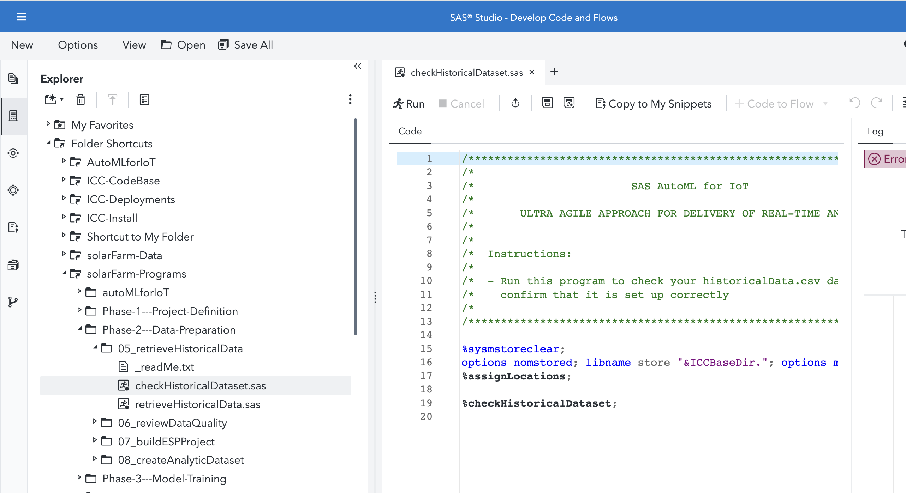

# Retrieve Historical Data from a Configured Data Source

Use this procedure when the project already has a historical database connection or a ClearBlade connection configured.

AutoML for IoT can use those data-source definitions to retrieve the historical sensor data required for the project and create:

```text
<projectName>/data/input/historicalData.csv
```

## Run the Historical Data Retrieval

Open and run:

```text
retrieveHistoricalData
```

The program uses the data sources configured earlier to retrieve the required historical records.



## Default Date Range

By default, the retrieval process uses the historical period required by the project's model definitions.

Users are provided with an optional way to specify an explicit start and end date in the retrieval program when a different historical period is needed.

```text
%automl_retrieveHistoricalData (startDate=01Apr2023,endDate=30Jun2023);
```

Use that override only when the project specifically requires a different retrieval window.

## Monitor Retrieval Progress

As records are retrieved, the program reports progress.

When retrieval is complete, the generated historical file is written to:

```text
<projectName>/data/input/historicalData.csv
```


## Understand the Generated File

At its core, `historicalData.csv` is simply a chronological list of individual sensor updates.

Each row represents **one update to one sensor value** in the digital twin.

An example set of historical data records is as follows:

```csv
I,N,1,data,1714492800000000,STR1,current_A,7.8
I,N,1,data,1714492800000000,STR2,current_A,8.1
I,N,1,data,1714492800000000,CBX1,CMBX_temperature_C,31.2
I,N,1,data,1714492860000000,STR1,current_A,7.9
I,N,1,data,1714492860000000,STR2,current_A,8.2
I,N,1,data,1714492860000000,CBX1,CMBX_temperature_C,31.4
```

The first 4 fields are fixed ESP constructs, with the remaining 4 fields being:

```text
timestamp
assetID
attributeID
value
```

Therefore, the first record above means that:

> At UTC timestamp `1714492800000000` (Tue Apr 30 2024 16:00:00.000), the `current_A` attribute for asset `STR1` was updated to `7.8`.

AutoML for IoT replays these rows in timestamp order so the digital twin changes in the same sequence as if the measurements had arrived live.

### Standard Field Definitions

Each standard row contains the following eight fields:

| Position | Field | Requirement |
|---:|---|---|
| 1 | `opcode` | `"I"` or `"i"` |
| 2 | `flag` | `"N"` or `"n"` |
| 3 | `index` | Integer key; it can remain `1` for every record |
| 4 | `category` | `"data"` for normal sensor updates |
| 5 | `timestamp` | UTC epoch time in microseconds |
| 6 | `assetID` | Asset being updated |
| 7 | `attributeID` | Raw attribute being updated |
| 8 | `value` | New sensor value |

The CSV has **no header row** and the records are sorted in **nondecreasing timestamp order**. Multiple records can have the same timestamp.

A typical file contains updates for many assets and attributes over multiple time periods.

## Validate the Historical Dataset

After retrieval, run:

```text
checkHistoricalDataset
```

The validation program checks the integrity of the historical records and reports errors in the log.



Before continuing, confirm that:

- the file contains no header row
- records are sorted in nondecreasing timestamp order
- every populated `assetID` references a valid project asset
- every populated `attributeID` references a valid raw attribute
- the recorded value is compatible with the configured attribute data type
- timestamps are expressed as epoch microseconds

## Next

After the historical file is generated and passes validation, continue to [Reviewing Data Quality](../reviewing-data-quality/README.md).
