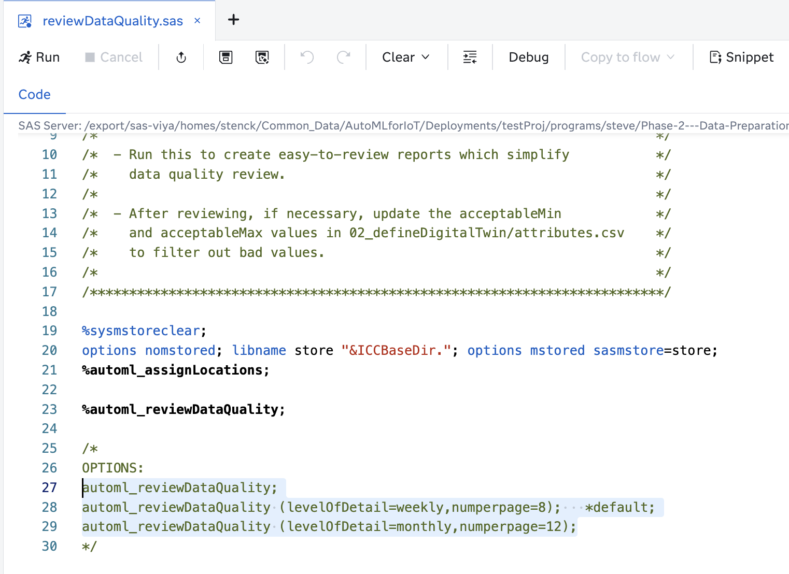
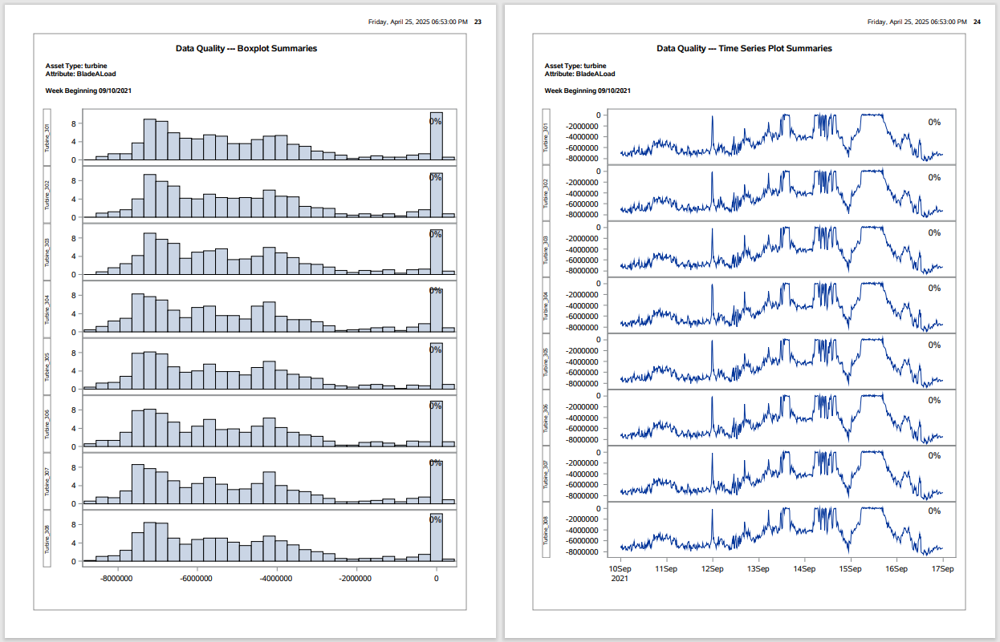

# Reviewing Data Quality

Before creating analytic-ready datasets, it is often useful to review the historical sensor data for patterns, missingness, and unexpected values.

This step helps you determine whether:

- patterns are reasonable for individual assets
- assets of the same type behave consistently
- unexpected high or low values are present
- missing data is concentrated in particular assets or time periods
- the acceptable minimum and maximum rules defined for raw attributes should be adjusted

This step is **optional**. If the project data has already been reviewed and the attribute quality rules are known to be appropriate, you can continue without running it again.

## Where to Run the Review and Find the Results

The program used for this step and the reports it creates are both located in:

```text
Phase-2---Data-Preparation/
└── 06_reviewDataQuality/
    ├── reviewDataQuality.sas
    └── Summary-of-Data-Quality---Run-At-<timestamp>---<assetType>.pdf
```

Open and run:

```text
Phase-2---Data-Preparation/06_reviewDataQuality/reviewDataQuality.sas
```

The program creates PDF data-quality summaries for the asset types in the project. The generated PDFs are written back into the **same `06_reviewDataQuality` directory**, so the program and its output are easy to find together.

Each report filename identifies when the report was created and the asset type being reviewed. For example:

```text
Summary-of-Data-Quality---Run-At-20260826145623---refrig.pdf
```

These summaries are intended for rapid visual review before the historical data is transformed into analytic-ready datasets.

## What to Review

Use the reports to look for:

- unexpected spikes or drops
- ranges that do not make physical or business sense
- differences between assets that should behave similarly
- prolonged periods with no measurements
- recurring gaps or missing values
- patterns that indicate a sensor or source-system issue

If a value is clearly outside the valid operating range for an attribute, review the acceptable-value rules configured for that raw attribute.

For details about defining `acceptableMin`, `acceptableMax`, and the corresponding handling logic, see [Define Attributes](../describing-your-digital-twin/attributes.md).

## Customize the Review

By default, the reports summarize data:

```text
weekly
```

and display as many as:

```text
8
```

assets per page.

The program includes examples showing how to override these defaults.



Two documented parameters control the report layout.

### `levelOfDetail`

Supported values are:

| Value | Behavior |
|---|---|
| `weekly` | Show one week of data per report page |
| `monthly` | Show one month of data per report page |

Use `weekly` when you want a more detailed view of shorter-term patterns.

Use `monthly` when you want a broader view across a longer period.

### `numPerPage`

Supported values are:

```text
4
8
12
```

This controls how many assets are graphed on each report page.

Use fewer assets per page when individual plots need more visual space. Use more assets per page when the primary goal is to compare many assets quickly.

## Review the Generated Reports

When the program finishes, open the generated `Summary-of-Data-Quality---...pdf` files in the same `06_reviewDataQuality` directory.

It is recommended that users view the reports in a PDF viewer using a two-page layout.

The report pages show the selected week or month across groups of 4, 8, or 12 assets.



Use this layout to compare similar assets side by side.

## Review Missing Data

The reports include missing-data information for the displayed assets in the top right of each cell.

Use the missing percentage shown in each report cell to identify:

- assets with unusually high missingness
- periods where a sensor stopped reporting
- asset groups whose data completeness differs from their peers

Missing data does not automatically mean the project configuration is incorrect. Use the report to determine whether the missingness reflects expected operations or a data-quality problem that should be addressed before analytic dataset creation.

## Review Unexpected Values

If the reports reveal values that are clearly too high or too low, return to the raw-attribute definition and review the acceptable-value rules.

Raw attributes can define:

```text
acceptableMin
acceptableMinLogic
acceptableMax
acceptableMaxLogic
```

When a minimum or maximum is specified, the associated logic determines how values outside the acceptable range are handled.

The documented logic values are:

- `limit` — pull values outside the range back to the specified minimum or maximum
- `missing` — treat values outside the range as missing

Only change these limits when the observed data and the actual use case justify the change. The purpose of the quality review is to help identify where the current rules may need refinement.

## Compare Assets of the Same Type

One advantage of the generated reports is that they place multiple assets of the same type together.

For example, if most strings in a solar array show similar current patterns but one string consistently behaves differently, that may indicate:

- a real equipment difference
- an operating condition that needs investigation
- a sensor problem
- a data collection problem

The quality review helps surface those differences before they become part of the analytic datasets used later in the workflow.

## Decide Whether Changes Are Needed

After reviewing the reports, there are two possible outcomes.

### No Changes Needed

If the patterns, ranges, and missingness are acceptable, continue to analytic dataset creation.

### Attribute Rules Need Adjustment

If clearly invalid values are present, update the appropriate raw-attribute acceptable minimum or maximum rules and rerun the relevant project preparation and quality-review steps before continuing.

The goal is to make sure the data entering the analytic dataset reflects the intended treatment of invalid sensor values.

## Next

After the historical data quality is acceptable, create the analytic-ready datasets that will be used for downstream analysis and model training. For details, see [Creating Analytic Datasets](../creating-analytic-datasets/README.md).

## Related Information

For the raw-attribute range and invalid-value settings that may be refined after this review, see [Define Attributes](../describing-your-digital-twin/attributes.md).
