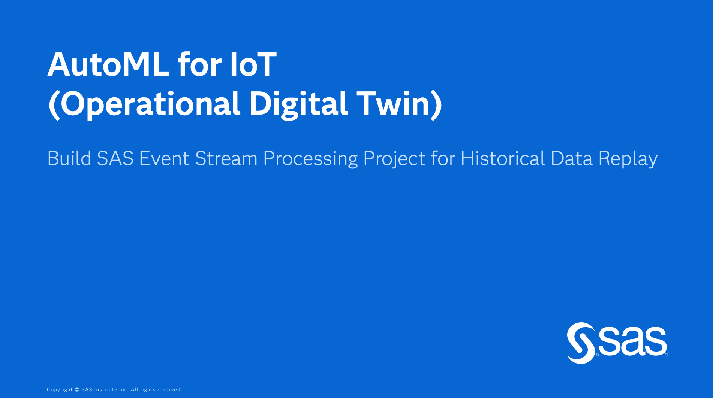
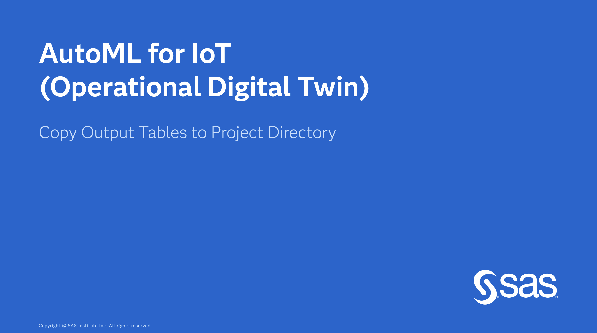
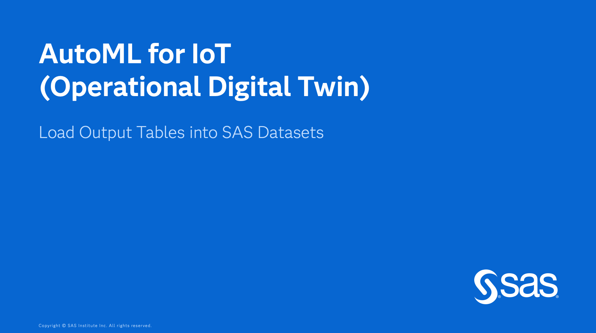

# Scoring Analytic Datasets

Earlier, you replayed your historical raw data to create analytic datasets. And, in the 'Model Training' step, you trained the desired models. Now, AutoML for IoT will integrate those analytical models into your ESP project, and that project can be used to replay the historical data to obtain 'scored' analytic datasets. These are the analytic datasets created earlier - but now with model predictions added. This will allow you to review how the models would have performed for your historical data and can be used to help define business rules and alerts that compare actual values to model predictions. All of the steps required have been **fully automated**, but we've included programs to address each of the steps needed. 

At a high level, the following steps will be performed by SAS AutoML for IoT. 

- builds the SAS Event Stream Processing project needed to create the scored analytic tables (including loading the project to SAS Event Stream Processing Studio and SAS Event Stream Manager)

- replays the historical data using SAS Event Stream Processing Studio

- copies the scored output tables from the SAS Event Stream Processing server to your project directory

- OPTIONAL - loads the scored output tables into SAS datasets for review in Viya / Viya Workbench

Each of these steps is described in detail in the sections below. Each step is **fully automated**, but the user will complete them interactively.

## Build the SAS Event Stream Processing Project

The below powerpoint will show you how SAS AutoML for IoT can automatically build the SAS Event Stream Processing project needed to replay and score your historical data. You will learn where that project is created and how the project is structured.

Step-by-Step Guide         |  
:-------------------------:|
 |

## Replay the Historical Raw Data using SAS Event Stream Processing

The below powerpoint will show you how SAS AutoML for IoT can automatically replay your historical dataset. It will show you what you will see during the replay as well as how to view the running project in SAS Event Stream Processing Studio.

Step-by-Step Guide         | 
:-------------------------:|
 |

## Copy the Output Tables from the SAS Event Stream Processing Server to Your Project Directory

The below powerpoint will show you how to copy the scored output tables from the SAS Event Stream Processing server back to your project directory so that the files can later be used to test out business rule logic.

Step-by-Step Guide         |  
:-------------------------:|
 |

## OPTIONAL - Load and Review the Output Tables as SAS Datasets

The below powerpoint will show you how to load the scored output tables into SAS datasets. With the datasets in SAS, you can explore the data using various SAS procedures, examine how the model predictions performed for specific time periods or conditions, etc.

Step-by-Step Guide         | 
:-------------------------:|
 |

      
