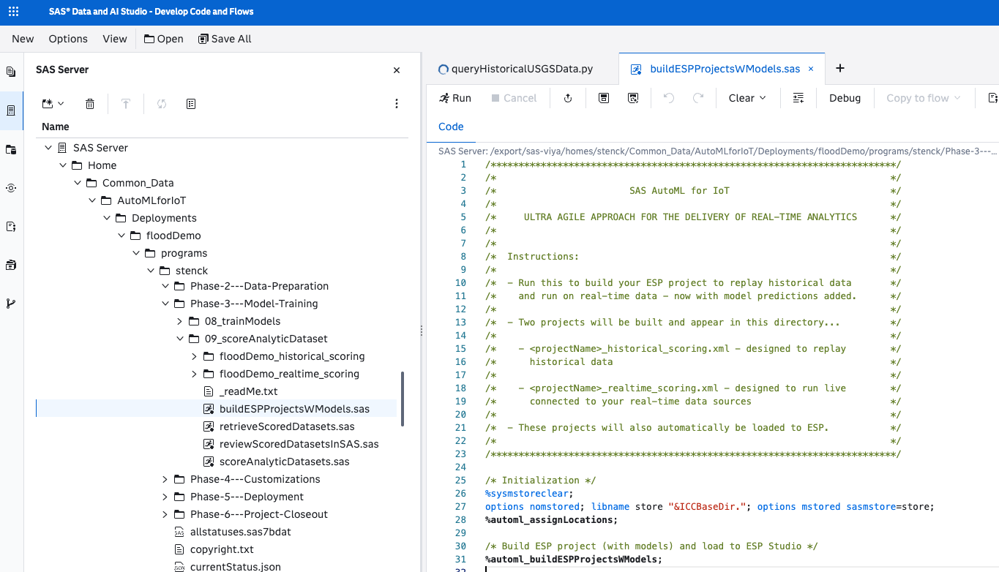
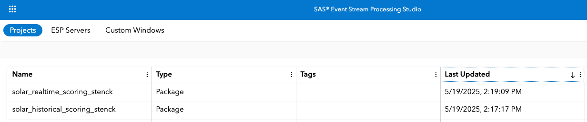
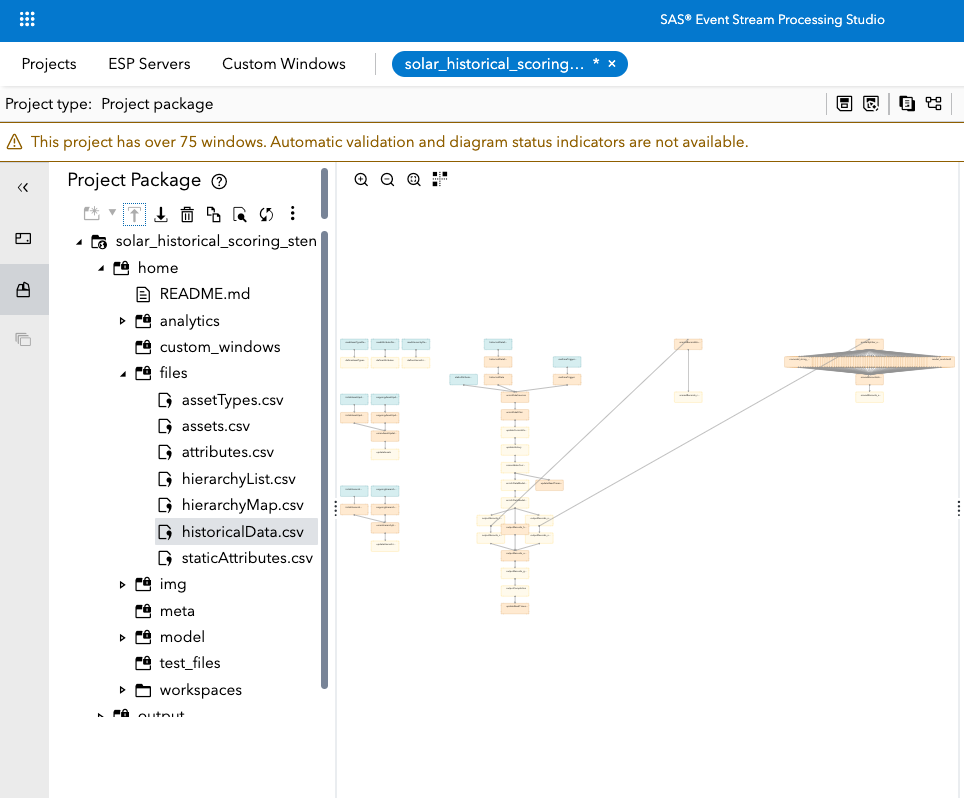
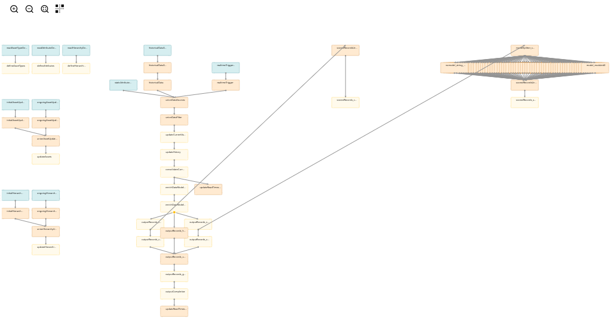

# Build the SAS Event Stream Processing Projects with Trained Models

The first scoring task is to build new SAS Event Stream Processing projects that include the trained analytical models.

## Run `buildESPProjectWModels`

Open and run:

```text
buildESPProjectWModels
```



The program creates ESP projects that combine the digital-twin logic, data enrichment, output definitions, and deployed model scoring.

## Projects That Are Created

Two SAS Event Stream Processing projects are automatically generated:

```text
Phase-3---Model-Training/
└── 09_scoreAnalyticDataset/
  ├── <projectName>_historical_scoring/
  │   └── Historical ESP project used to replay training data with model predictions added
  │
  └── <projectName>_realtime_scoring/
      └── Real-time ESP project with the same analytic logic
```

### Historical Scoring Project

```text
<projectName>_historical_scoring
```

replays the historical data, transforms the sensor events into analytic-ready records, and scores those records with the trained models.

### Real-Time Scoring Project

```text
<projectName>_realtime_scoring
```

runs against the live data path. It transforms incoming sensor records and scores the resulting analytic records with the deployed models.

## Review the Projects in ESP Studio

The generated scoring projects are automatically loaded into SAS Event Stream Processing Studio for inspection and testing.



Note that the user's ID will be appended to the project name so multiple users can work with copies of the same project.

## Optional: Test the Historical Scoring Project

To test the historical scoring project manually:

1. upload the historical dataset to the `/home/files` location for the historical project
2. open the project in ESP Studio
3. select **Enter Test Mode**



This manual test is optional. The normal workflow uses the automated scoring program described in the next task.

## Understand the Project Structure

The scoring project contains the same major components as the earlier ESP project, with one important addition: the trained models are deployed into the stream.

Note that the project contains these major areas:

- digital-twin setup
  - asset types
  - attributes
  - assets
  - hierarchy
- data ingestion
- data enrichment, when configured
- output-table creation
- deployed models



## Previous

For the trained models that are integrated into these projects, see [Model Training](../model-training/README.md).

## Next

After the scoring ESP projects have been built, replay the historical sensor data and generate scored records. See [Replay Historical Data and Score the Analytic Dataset](score-analytic-datasets.md).
