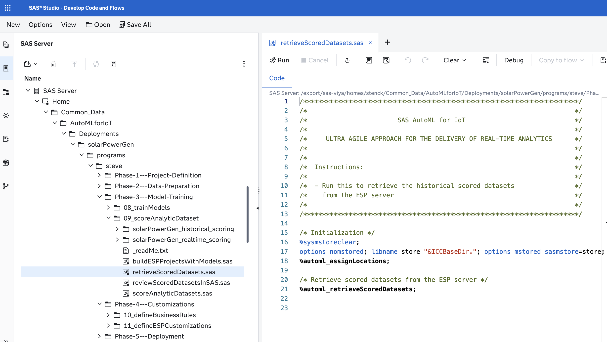
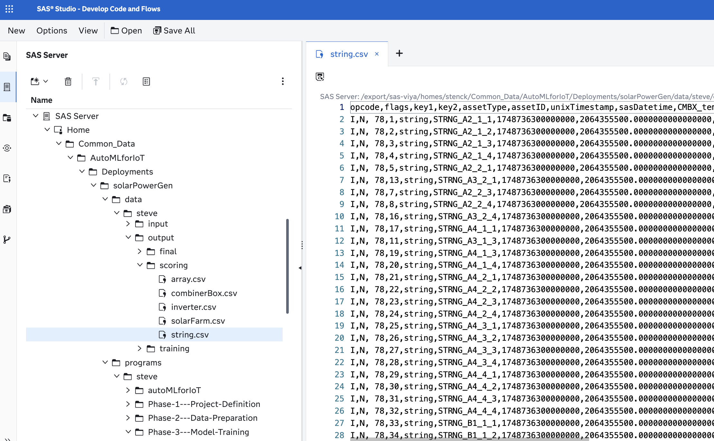

# Copy the Scored Output Tables to the Project Directory

After historical scoring completes, the generated scored datasets reside on the SAS Event Stream Processing server.

Copy them into the AutoML for IoT project so they can be reviewed and used in later customization work.


This is the scoring equivalent of the earlier `retrieveAnalyticDatasets` step: it copies the generated output tables back into the project, but these tables now include model scoring results.
## Run `retrieveScoredDatasets`

Open and run:

```text
retrieveScoredDatasets
```



The program copies the scored output datasets from the ESP server back to the project directory.

## Output Location

The scored datasets are stored in:

```text
<projectName>/data/<user>/output/scoring
```



These datasets are the historical analytic records with model scoring results added.

They can now be used to review model behavior and to help design business-rule logic or other project customizations.

## Previous

If historical scoring has not yet completed, see [Replay Historical Data and Score the Analytic Dataset](score-analytic-datasets.md).

## Next

You can proceed to project customizations or optionally load the scored datasets into SAS for detailed review. See [Load and Review Scored Datasets in SAS](review-scored-datasets-in-sas.md).
