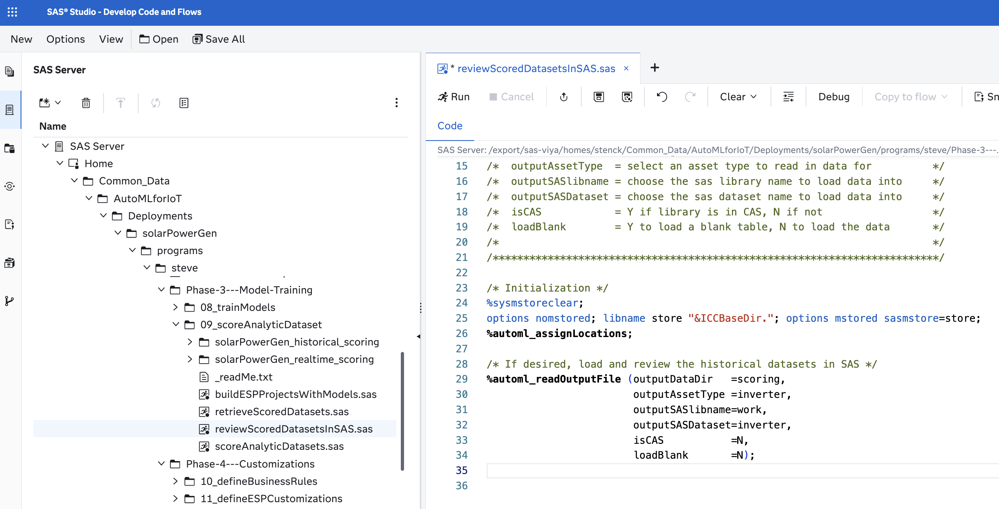
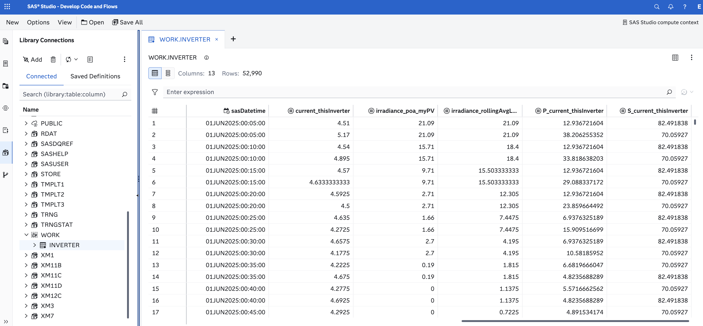

# Load and Review Scored Analytic Datasets in SAS

This step is optional.

Use it when you want to inspect the scored historical output in SAS before defining business rules or other project customizations.


This is the scoring equivalent of reviewing the earlier analytic datasets in SAS. The difference is that the scored tables also contain the model results, allowing you to review predictions alongside the historical data.
## Run `reviewScoredDatasetsInSAS`

Open:

```text
09_scoreAnalyticDataset/reviewScoredDatasetsInSAS
```

Populate the asset type, library name, and dataset name, then execute the macro.



## Output Library

By default, the loaded dataset is written to the SAS `WORK` library.

To use a different library, specify:

```text
outputSASlibname
```

If the destination is a CAS library, specify:

```text
isCAS=Y
```

## Load Only the Dataset Structure

To create a blank SAS table containing only the expected scored-output structure, specify:

```text
loadBlank=Y
```

This can be useful when you want to inspect the available columns without loading the historical rows.

## Review Predictions and Standard Errors

After the scored table is loaded, open the SAS libraries view and navigate to the selected dataset.



Note that the scored dataset includes model **predictions and standard errors**.

This allows you to examine:

- actual values versus model predictions
- periods where prediction errors are unusually large
- model behavior under specific operating conditions
- potential thresholds or comparisons that could later become business rules or alerts

## Why Review Scored Historical Data

Scoring the historical data allows you to see how the deployed model logic would have behaved before using it against live streaming data.

The scored records can therefore help inform later project customizations, especially rules that compare observed values with model predictions.

## Previous

If the scored datasets have not yet been copied into the project, see [Copy the Scored Datasets to the Project Directory](retrieve-scored-datasets.md).

## Next

When scoring review is complete, continue to [Adding Customizations](../adding-customizations/README.md).
