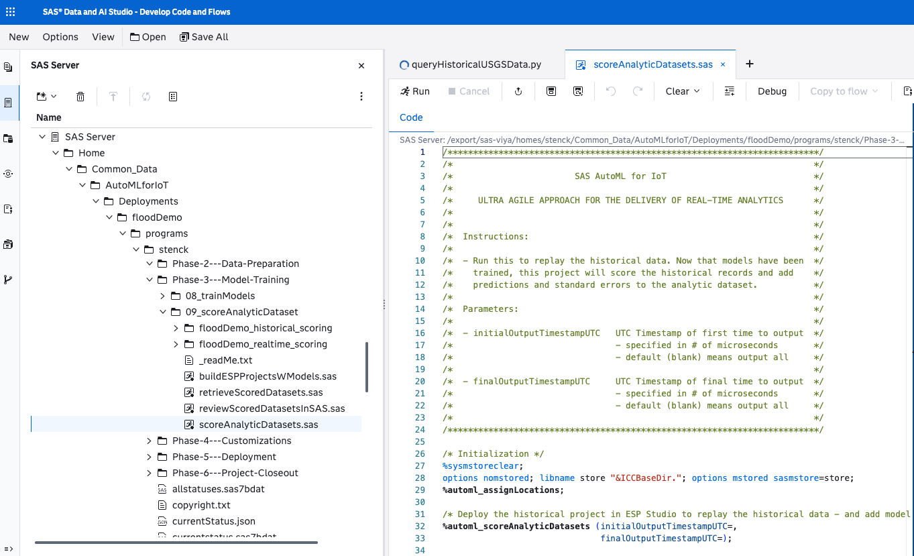
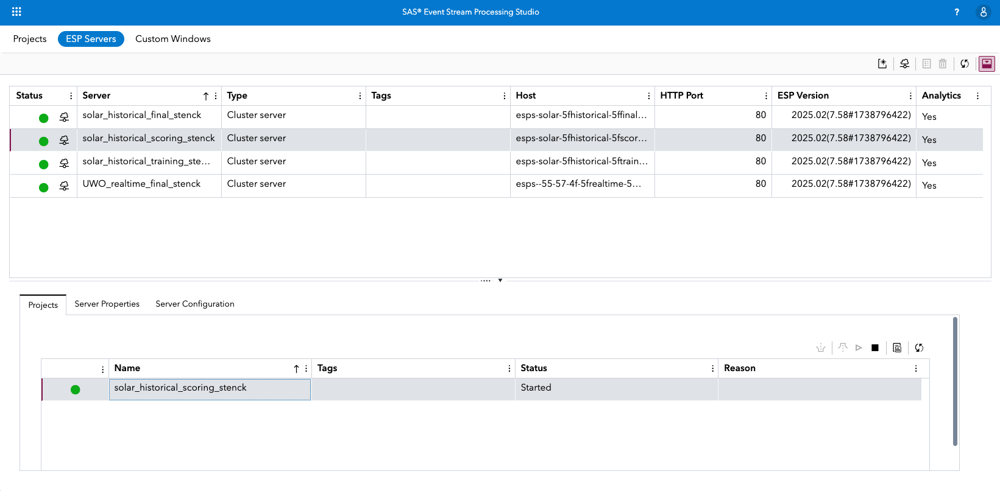
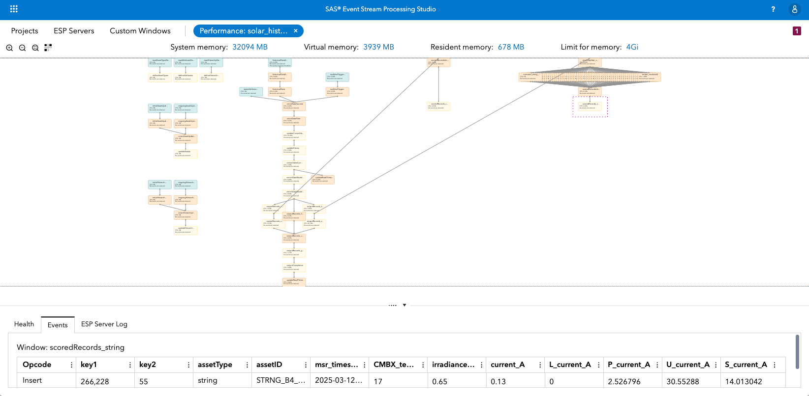
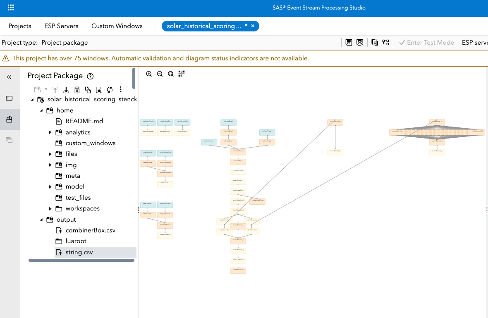

# Replay Historical Data to Create Scored Analytic Datasets

After the scoring ESP projects have been built, replay the historical sensor data to create analytic datasets with model predictions.

## Run `scoreAnalyticDatasets`

Open and run:

```text
scoreAnalyticDatasets
```



This program automates the historical scoring lifecycle:

1. creates a new ESP server deployment
2. loads the historical scoring project
3. starts the project
4. monitors the log while historical replay runs
5. waits for replay and scoring to complete
6. deletes the temporary ESP server deployment

## Optional Replay Boundaries

Two optional parameters can restrict the historical scoring period:

```text
initialOutputTimestampUTC
finalOutputTimestampUTC
```

Both are UTC epoch timestamps expressed in **microseconds**.

### `initialOutputTimestampUTC`

This specifies the first output time.

When left missing, replay starts from the beginning of the historical CSV file.

### `finalOutputTimestampUTC`

This specifies the final output time.

When left missing, replay continues through the end of the historical CSV file.

Both fields are typically left missing unless a specific historical scoring window is required.

## Optional: Monitor the Running Scoring Project

You can inspect the historical scoring run directly in SAS Event Stream Processing Studio.

Open the **ESP Servers** area, select the running project, and open its **Performance** view.



## Monitor Raw, Output, and Scored Events

The **Events** view can be used to inspect individual ESP windows while scoring is running.

Three windows that are typically helpful to review are:

```text
historicalData
```

shows the historical raw records flowing into the project.

```text
outputRecords_<assetType>
```

shows the analytic-ready output records for that asset type.

```text
scoredRecords_<assetType>
```

shows the scored records, including model predictions.



This provides a useful way to compare the progression from raw events to analytic records to model-scored records.

## Generated Scored Datasets

As the historical scoring project runs, it generates structured scored output tables in the ESP project package.



These records contain the analytic data together with the model scoring output.

The next task copies those datasets back into the AutoML for IoT project directory.

## Previous

If the scoring projects have not yet been generated, see [Build the ESP Projects with Trained Models](build-scoring-esp-projects.md).

## Next

After historical scoring completes, copy the resulting scored datasets into the project directory. See [Copy the Scored Datasets to the Project Directory](retrieve-scored-datasets.md).
