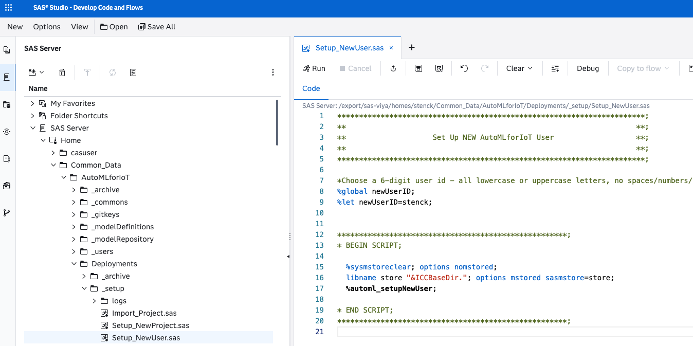
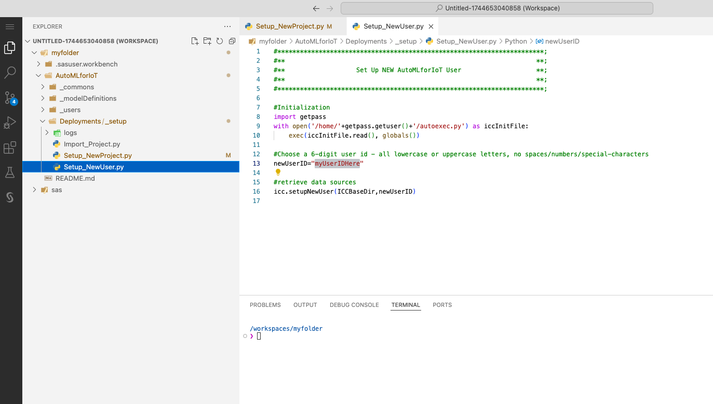
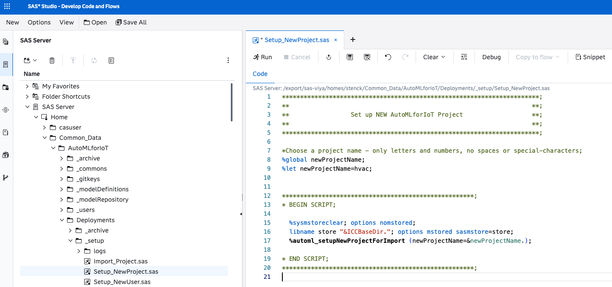
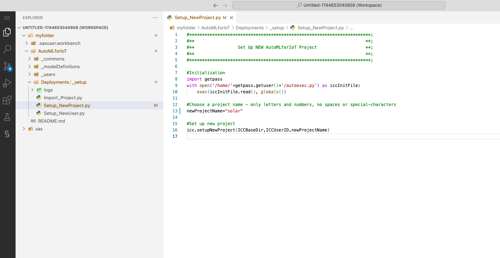
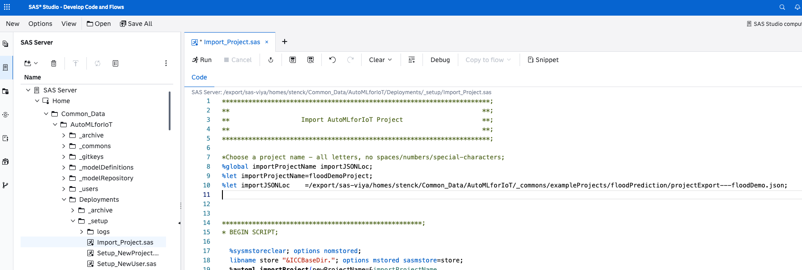
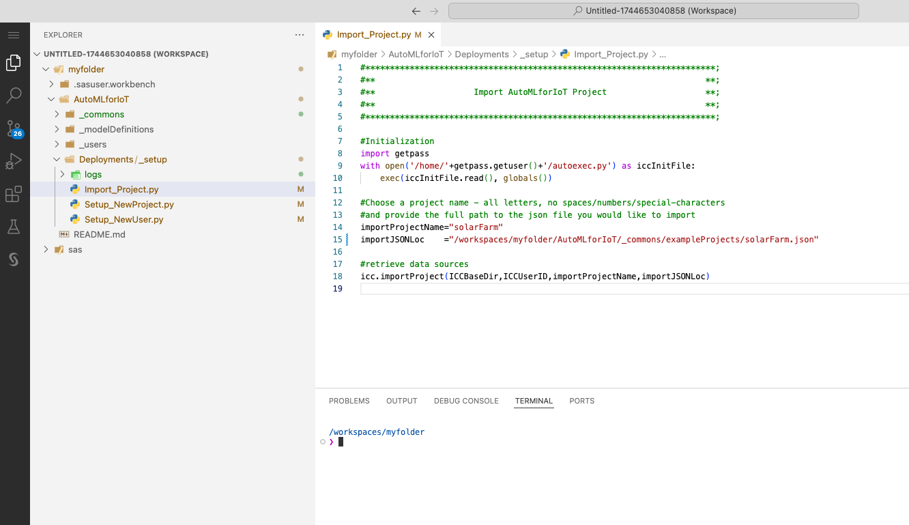

# Setting Up Your First Project

After installing AutoML for IoT, choose the setup task you need.

## On This Page

- **[Set Up a New AutoML for IoT User](#set-up-a-new-automl-for-iot-user)** — Set yourself up as an AutoML for IoT user.
- **[Create a New Project](#create-a-new-project)** — Start with a new blank AutoML for IoT project.
- **[Import an Existing Project](#import-an-existing-project)** — Import a saved, training, example, or AI-assisted project.

The instructions below cover both SAS Viya and SAS Viya Workbench.

---

<a id="set-up-a-new-automl-for-iot-user"></a>

## Set Up a New AutoML for IoT User

AutoML for IoT requires you to assign yourself a user ID. Complete this step once for each AutoML for IoT user.

### SAS Viya

Open:

```text
/AutoMLforIoT/Deployments/_setup/Setup_NewUser.sas
```

Edit the `newUserID` value.

Use a short identifier containing only letters - typically 5–10 characters.

For example:

```text
newUserID = myuser
```

Run `Setup_NewUser.sas`.



### SAS Viya Workbench

Open:

```text
/AutoMLforIoT/Deployments/_setup/Setup_NewUser.py
```

Edit the `newUserID` value.

Use a short identifier containing only letters - typically 5–10 characters.

For example:

```text
newUserID = myuser
```

Run `Setup_NewUser.py`.



---

<a id="create-a-new-project"></a>

## Create a New Project

Use this path when you want to begin with a blank AutoML for IoT project.

### SAS Viya

Open:

```text
/AutoMLforIoT/Deployments/_setup/Setup_NewProject.sas
```

Enter the desired project name in `newProjectName`, then run the program.

The new project is created under:

```text
/AutoMLforIoT/Deployments
```

The project contains the directory structure and phase programs used throughout the AutoML for IoT lifecycle.



### SAS Viya Workbench

Open:

```text
/AutoMLforIoT/Deployments/_setup/Setup_NewProject.py
```

Enter the desired project name in `newProjectName`, then run the program.

The project is created under:

```text
/AutoMLforIoT/Deployments
```



---

<a id="import-an-existing-project"></a>

## Import an Existing Project

Use this path when you already have an AutoML for IoT project export.

This includes:

- a project exported from another AutoML for IoT environment
- a project created with the AutoML for IoT AI Assistant
- one of the packaged training or example projects

### Locate the Project Export

Packaged examples are available under:

```text
/AutoMLforIoT/_commons/exampleProjects
```

Locate the project export you want to use and copy its file path.

### SAS Viya

Open:

```text
/AutoMLforIoT/Deployments/_setup/Import_Project.sas
```

Enter:

- the project name you want to use
- the path to the project export

Run the program.

When import completes, the project appears under:

```text
/AutoMLforIoT/Deployments
```



### SAS Viya Workbench

Open:

```text
/AutoMLforIoT/Deployments/_setup/Import_Project.py
```

Enter:

- the project name you want to use
- the path to the project export

Run the program.

When import completes, the project appears under:

```text
/AutoMLforIoT/Deployments
```



---

## Choose What to Do Next

If you want a guided introduction to the product, work through the five progressive training projects:

[Explore the Training Projects](training-projects.md)

If you want to see complete operational use cases, review the packaged example projects:

[Explore the Example Projects](example-projects.md)

If you are ready to configure your own use case, continue to the main project documentation:

[Open the AutoML for IoT Project Documentation](../enablement-home/README.md)

---

## Previous

If AutoML for IoT is not yet installed, return to [Installation](../installation/README.md).
