# Setting Up Your First Project 

## Setting Yourself Up as a New User

You've installed the code. Now you need to register yourself as a user. 

The below powerpoint will walk you through the process of setting yourself up as a new SAS AutoML for IoT user.

Step-by-Step Guide for Viya        |Step-by-Step Guide for Viya Workbench        |
:-------------------------:|:-------------------------:|
 | <a href="ppt/Setting-Up-New-User-ViyaWorkbench.pptx">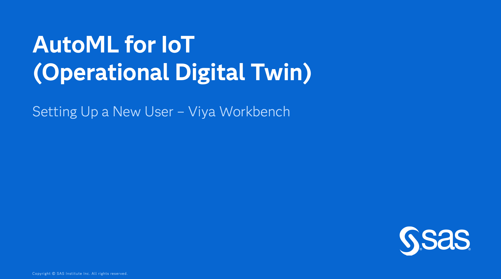</a> |

## Setting Up a New Project

If you are ready to get started with a blank project, let's go! The below powerpoint will walk you through the process of creating a blank project or importing one of our training or example projects (described below).

Step-by-Step Guide for Viya        |Step-by-Step Guide for Viya Workbench        |
:-------------------------:|:-------------------------:|
 |  |

## Training Projects

If you are new to SAS AutoML for IoT, you may want to begin by testing out the five training projects we've created in the next section. 

We have developed five training projects that will introduce you to the commonly used features of SAS AutoML for IoT. These projects are designed to be explored in order (from 1 to 5), and each project adds new features. Click on one of the powerpoints below to learn how to set up that training project.

### training1 

**Key Concepts**
* Creates one output table for a single asset type that contains only information from that one asset type.

Step-by-Step Guide         |
:-------------------------:|
<a href="ppt/TrainingProject1.pptx">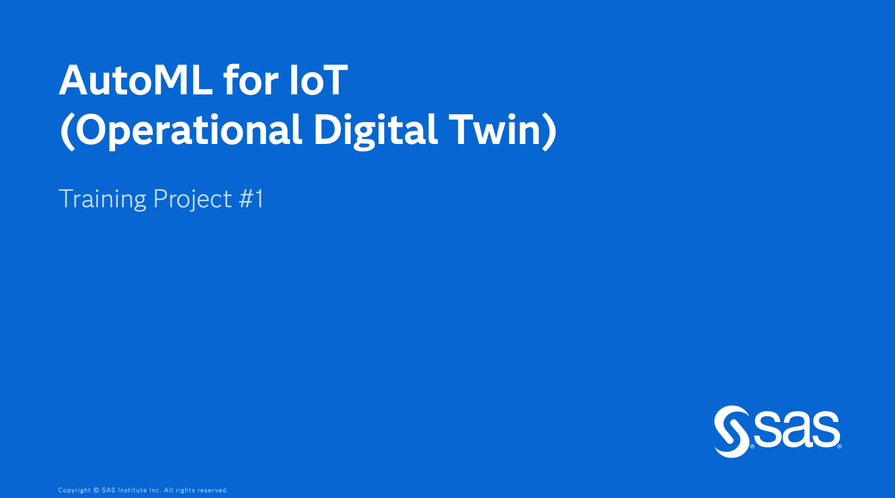</a> |

### training2 

**Key Concepts**
* Introduces the concept of a hierarchy which connects assets together.
* Creates output tables for *each* asset type - and each table contains information from potentially multiple connected assets.

Step-by-Step Guide         |
:-------------------------:|
 |

### training3 

**Key Concepts**
* Adds data enrichment and defines new derived attributes that look back in time (lag), aggregate information across connected assets (relationalAgg) and execute code (code).

Step-by-Step Guide         |
:-------------------------:|
 |

### training4 

**Key Concepts**
* Adds analytical models to predict an outcome (in this example, energy generation for a solar farm). Three different approaches to training the models are shown - one model is trained for the solarFarm, distinct models are trained for *each* inverter, and a third set of models are trained for groups of solar panel strings (grouped by their capacity).

Step-by-Step Guide         |
:-------------------------:|
 |

### training5 

**Key Concepts**
* Adds customizations - in this case, business rules are added which compute an efficiency measure for each of the 3 asset type models - this compares actual power generation to the predicted values coming from the models.

Step-by-Step Guide         |
:-------------------------:|
 |

## Example Projects

And... if you would like to explore some fully operational projects in detail, we've included several examples that cover a variety of use cases. Each of these use publicly available data and can be imported and worked through step by step to understand the full capabilities of the solution.

### Solar Power Generation

This project queries information about a solar farm from a ClearBlade instance (an accelerated integration). Energy generation at the solar panel string level is aggregated up to other levels of the solar farm and ML models are deployed to model power generation at each level of the solar farm. Since the ClearBlade instance is internal to SAS, users will only be able to run through the historical replay of this example and will not set the project live.

Thumbnail 1        | Thumbnail 2        | Thumbnail 3 | Thumbnail 4 | Thumbnail 5 |
:-------------------------:|:-------------------------:|:-------------------------:|:-------------------------:|:-------------------------:|
</a> | </a> | 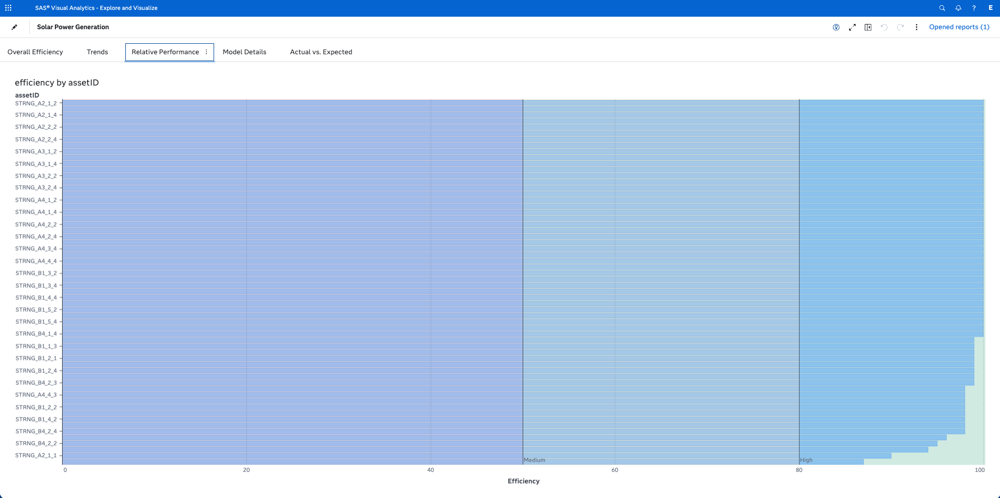</a> | </a> | </a> |
 
Step-by-Step Guide         |
:-------------------------:|
 |

### NYC Subway Train Monitoring 

This project queries information from publicly available APIs to gather information as to where each train is currently located. A digital twin of the entire subway system is maintained. Every minute, calculations are made to determine travel times between stations, wait times at each platform, and expected completion of the train's route given current conditions.
 
Thumbnail 1        | Thumbnail 2        | Thumbnail 3 | 
:-------------------------:|:-------------------------:|:-------------------------:|
</a> | 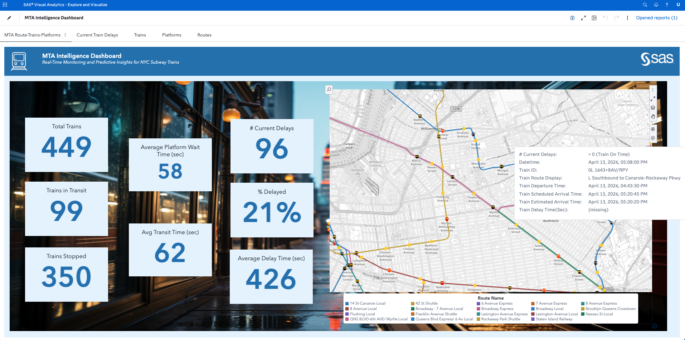</a> | 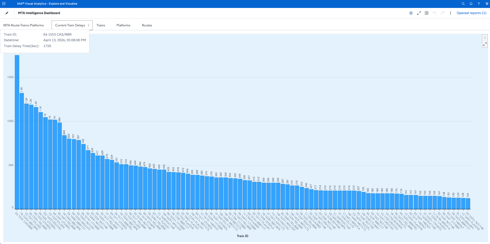</a> | 

Step-by-Step Guide         |
:-------------------------:|
 |

### Flood Prediction (North Carolina)

This project queries information from the USGS regarding river gauge heights and from a weather API to gather rain amounts and forecasts. Changes in gauge heights upstream and information about rainfall amounts are used to predict future gauge height levels up to 6 hours into the future, with ML models deployed individually for every river segment.
 
Thumbnail 1        | Thumbnail 2        | Thumbnail 3 | 
:-------------------------:|:-------------------------:|:-------------------------:|
</a> | 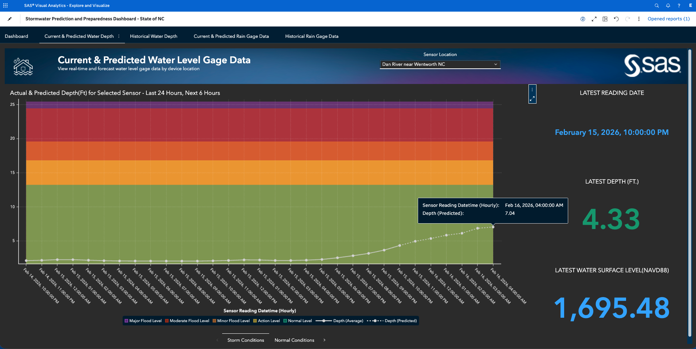</a> | 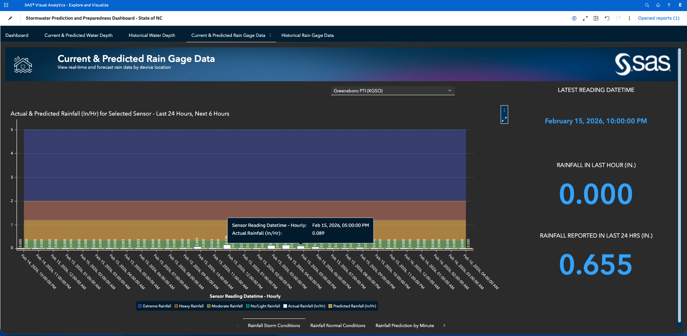</a> | 

Step-by-Step Guide         |
:-------------------------:|
<a href="ppt/FloodPredictionProject.pptx">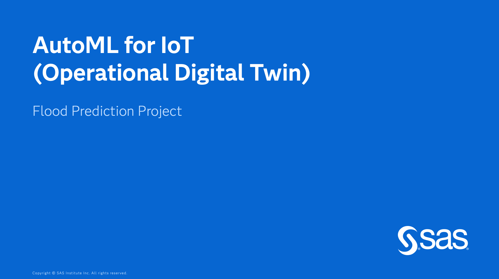</a> |

### Patient Sepsis Monitoring

This project monitors patients in a hospital who are at risk of sepsis. Regular updates are received about vitals signs and lab tests, and a patient risk probability is updated continuously using a machine learning model as new data arrives. This capability provides the hospital with a second set of eyes watching multiple inter-related metrics to ensure patient health and well-being is proactively managed.
 
Thumbnail 1        | Thumbnail 2        | Thumbnail 3 | 
:-------------------------:|:-------------------------:|:-------------------------:|
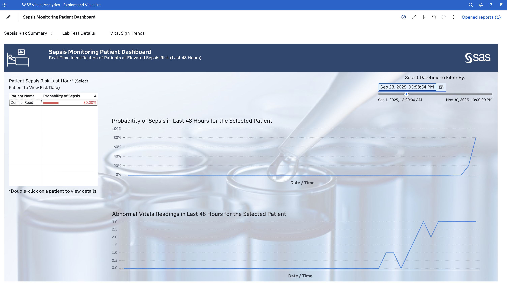</a> | </a> | </a> | 

Step-by-Step Guide         |
:-------------------------:|
 |

### Factory Production Monitoring

This project monitors a digital twin of a manufacturing line that produces sprockets. A furnace melts down and combines various metals and additives, pours the result into a mold for cooling, and then finishes each sprocket to smooth out any imperfections. A QA test is performed on the product three hours later to ensure the product is ready for sale. In this example, two concurrent approaches are used to monitor production. First, each batch is tracked as it is produced - attributes about the process are stored as the product moves through the production line, and a probability is assigned using an ML model as to whether the batch is likely to meet quality standards. This provides advance notice as to whether the product is likely to fail and allows the factory to operate more proactively. In addition, a second approach is implemented which continually watches current metrics across the factory and deploys an ML model which answers the question "if you continue to run the production line with these settings, then the quality is likely to be THIS in 3-4 hours". This provides an even greater degree of visibility for the factory technicians.

Thumbnail 1        | Thumbnail 2        | Thumbnail 3 | Thumbnail 4 |
:-------------------------:|:-------------------------:|:-------------------------:|:-------------------------:|
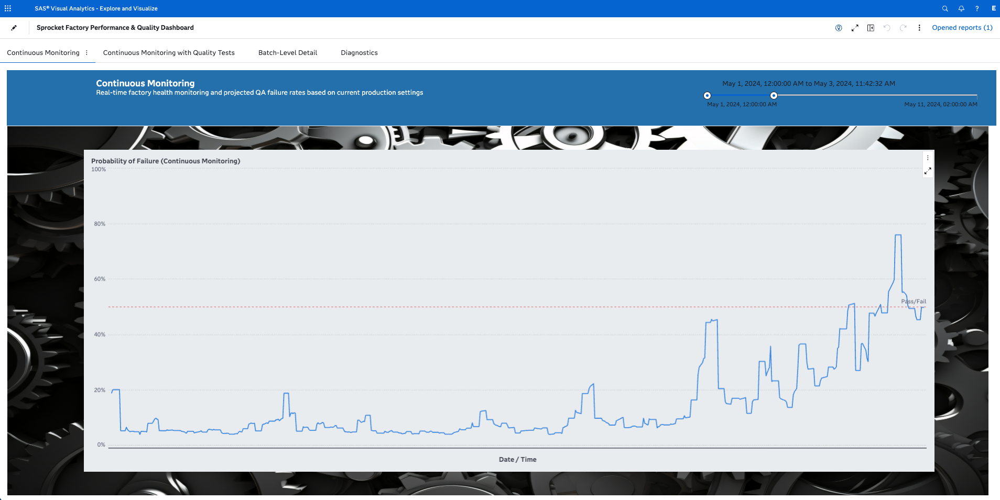</a> | 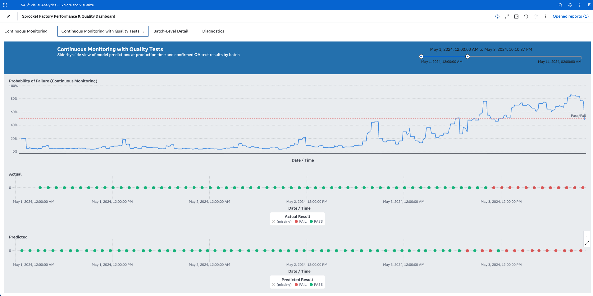</a> | </a> | </a> |
 
Step-by-Step Guide         |
:-------------------------:|
 |

      
