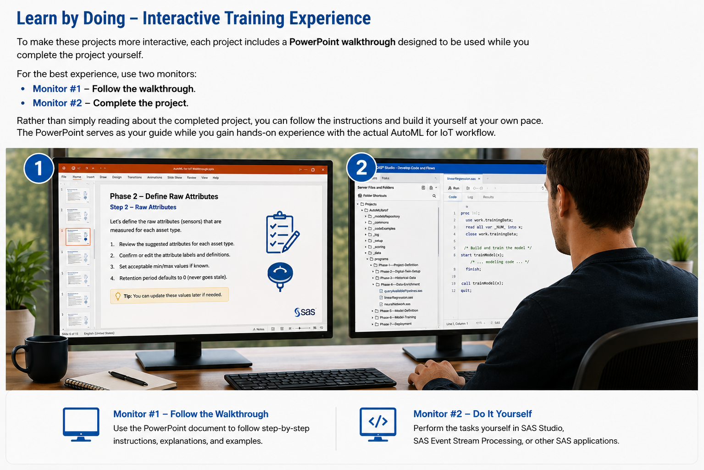
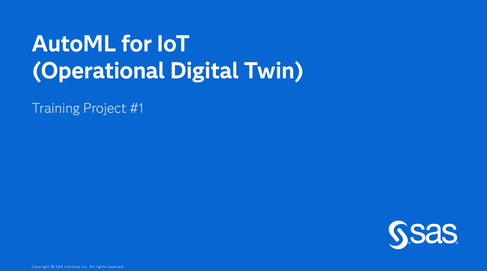
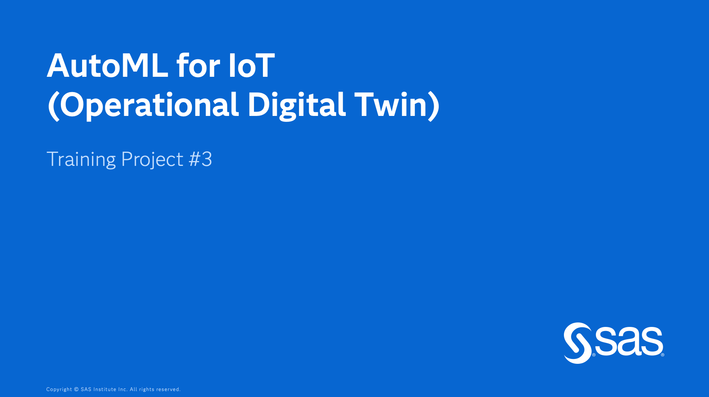

## Training Projects

If you are new to SAS AutoML for IoT, you may want to begin by testing out the five training projects we've created in the next section. 

We have developed five training projects that will introduce you to the commonly used features of SAS AutoML for IoT. These projects are designed to be explored in order (from 1 to 5), and each project adds new features. Click on one of the powerpoints below to learn how to set up that training project.

To make these projects more interactive, each project includes a **PowerPoint walkthrough designed to be used while you complete the project yourself**.

For the best experience, use two monitors:

- **Monitor #1 — Follow the walkthrough.** Keep the PowerPoint open for step-by-step instructions, explanations, and screenshots.
- **Monitor #2 — Complete the project.** Work through the same steps yourself in SAS Studio, SAS Event Stream Processing, or the other SAS applications used by the project.

Rather than simply reading about the completed project, you can **follow the instructions and build it yourself at your own pace**. The PowerPoint serves as your guide while you gain hands-on experience with the actual AutoML for IoT workflow.

### training1 

**Key Concepts**
* Creates one output table for a single asset type that contains only information from that one asset type.

Step-by-Step Guide         |
:-------------------------:|
 |

### training2 

**Key Concepts**
* Introduces the concept of a hierarchy which connects assets together.
* Creates output tables for *each* asset type - and each table contains information from potentially multiple connected assets.

Step-by-Step Guide         |
:-------------------------:|
 |

### training3 

**Key Concepts**
* Adds data enrichment and defines new derived attributes that look back in time (lag), aggregate information across connected assets (relationalAgg) and execute code (code).

Step-by-Step Guide         |
:-------------------------:|
 |

### training4 

**Key Concepts**
* Adds analytical models to predict an outcome (in this example, energy generation for a solar farm). Three different approaches to training the models are shown - one model is trained for the solarFarm, distinct models are trained for *each* inverter, and a third set of models are trained for groups of solar panel strings (grouped by their capacity).

Step-by-Step Guide         |
:-------------------------:|
 |

### training5 

**Key Concepts**
* Adds customizations - in this case, business rules are added which compute an efficiency measure for each of the 3 asset type models - this compares actual power generation to the predicted values coming from the models.

Step-by-Step Guide         |
:-------------------------:|
 |

[Back to Setting Up Your First Project](README.md)
