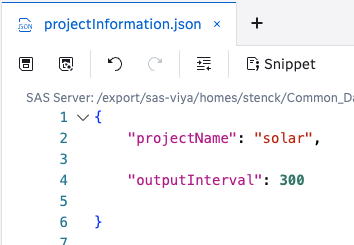
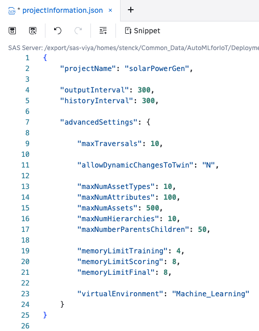

# Specifying Project Information

The first step in setting up your project is to provide high-level information about your project.

Specifically, you need to decide on:

- a project name
- how often you would like to output data, in seconds
- additional advanced settings, if needed

For most projects, only the project name and output frequency require a design decision. 

## Where the Configuration Goes

Project-level settings are stored in:

```text
Phase-1---Project-Definition/
└── 00_defineProject/
    └── projectInformation.json
```

Use `projectInformation.json` for the high-level settings that apply to the project as a whole, including the project name, output interval, history interval, and any advanced project settings described below.

## Choose a Project Name

Choose a short project name that identifies the use case.

The project name should:

- be 2–20 characters
- contain only letters and numbers
- be short enough to recognize easily in project files and generated content

For example:

```text
solar
solarFarm
hvacAnalytics
```

## Choose How Often to Output Data

Decide how often AutoML for IoT should output information about the digital twin.

Specify this interval in seconds.

Examples include:

| Desired output frequency | Value |
|---|---:|
| Every minute | `60` |
| Every 5 minutes | `300` |
| Every 10 minutes | `600` |
| Every 15 minutes | `900` |

A common choice is:

```text
300
```

which generates output every 5 minutes.

The output interval establishes the regular cadence at which AutoML for IoT generates structured output from the digital twin.

## Simple Configuration

For a basic project, the project information can be very small.



The training example above defines:

- a project named `solar`
- an output interval of `300` seconds

### Core Project Fields

There are three core fields in the projectInformation config file...

| Field | Type | Description |
|---|---|---|
| `projectName` | string | Short project name. Must contain only letters and numbers and must not exceed 20 characters. |
| `outputInterval` | number | Number of seconds between output records. Must be an integer of at least 60 seconds. |
| `historyInterval` | number | Resolution, in seconds, used for interval-based history. By default, this is set equal to `outputInterval`. |

### History Interval

The **history interval** controls how frequently AutoML for IoT stores a snapshot of the values currently in effect in the digital twin for use by time-based calculations.

By default, the history interval should be the same as the **output interval**. For example, if output records are created every 5 minutes, the history interval would normally also be 5 minutes.

The two intervals serve different purposes:

- The **output interval** determines how often AutoML for IoT calculates derived attributes and creates records for the configured output tables.
- The **history interval** determines the time resolution of the stored history that can be used by calculations that look backward across time.

In most projects, there is no reason to make the history interval different from the output interval. A shorter history interval can be useful when a **temporal aggregation** needs finer time resolution than the output frequency.

For example, a project might output one record every 15 minutes but need to calculate a rolling measure using values sampled every 5 minutes. In that case:

| Setting | Value |
|---|---:|
| Output interval | 900 seconds (15 minutes) |
| History interval | 300 seconds (5 minutes) |

With this configuration, AutoML for IoT maintains historical values every 5 minutes but creates the requested output records every 15 minutes.

The **output interval must be an integer multiple of the history interval**.


## Advanced Project Settings

Most projects do not require changes to the advanced settings.

The example below shows additional controls for:

- the maximum number of traversals AutoML for IoT can make when navigating the digital twin
- whether the structure of the digital twin can change while the project is running
- maximum project sizes
- memory allocated to training, scoring, and final projects
- a virtual environment to use when relevant Python packages are required



### Maximum Traversals

AutoML for IoT can navigate the digital twin to find requested information.

By default, a maximum of 10 traversals is used.

This setting limits how far the project can search while navigating asset relationships.

### Dynamic Changes to the Digital Twin

The advanced settings can indicate whether the structure of the digital twin can change while the project is running. Valid values are Y or N. The default is N.

Examples of dynamic structural changes include:

- adding or deleting assets
- adding or deleting connections between assets

For most use cases, the assets and their relationships remain fixed after the project starts.

### Project Size Limits

The detailed example also includes limits for the size of the project.

These limits cover items such as:

- number of asset types (default=100)
- number of attributes per asset type (default=1000)
- number of assets (default=10000)
- number of hierarchies (default=100)
- number of parents or children per asset (default=100)

Adjust these settings only when the expected project size requires different limits.

### Memory Settings

Advanced configuration can also control the memory allocated to:

- model training (default=1)
- model scoring (default=1)
- the final project (default=1)

Use these settings when a project requires different resource limits from the defaults. Users specify the number of gigabytes requires for each of the different types of projects - training, scoring, and final.

### Python Virtual Environment

If a project uses functionality that depends on Python packages, the advanced configuration can identify the virtual environment that contains those packages.

This is only needed for projects that use the relevant Python-based functionality. If required, an admin must configure the virtual environment first to contain the desired Python packages.

## Validate the Core Project Information

Before continuing, verify the following core settings:

- The project name is present.
- The project name contains only letters and numbers.
- The project name does not exceed 20 characters.
- The output interval is a numeric integer.
- The output interval is at least 60 seconds.
- The history interval is a numeric integer.
- The output interval is an integer multiple of the history interval.

## Next

After the project name and timing settings are defined, identify how AutoML for IoT will receive real-time and/or historical data. For details about the supported data-source patterns and how to configure them, see [Configuring Data Sources](../configuring-data-sources/README.md).

## Related Information

If you want to review the full project workflow before continuing, see [Enablement Home](../enablement-home/README.md).

The history interval defined here can be revisited later when time-based calculated metrics require a finer historical resolution. For details about those calculations, see [Configuring Derived Attributes](../configuring-derived-attributes/README.md).
