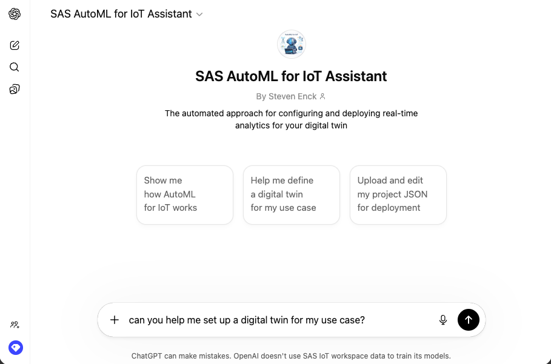
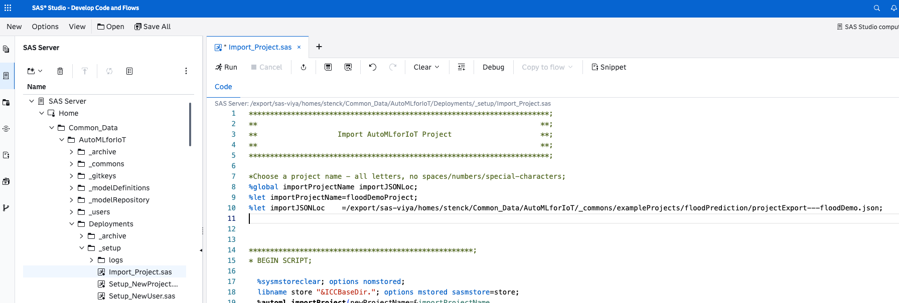
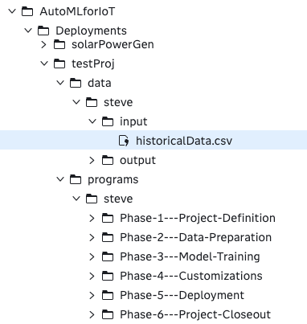
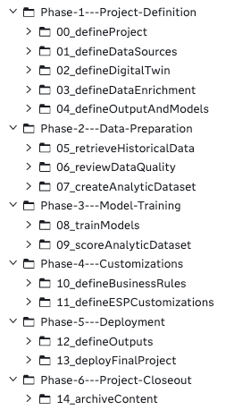

# Working with the AI Assistant

The AutoML for IoT AI Assistant can help you understand the solution, describe a new use case, or work with an existing project through a guided conversation.

The assistant follows the same AutoML for IoT configuration flow used throughout this documentation and can produce a consolidated project export that can be imported into AutoML for IoT.

## Security Guidance

Treat the AI Assistant like any other conversational AI tool used in your organization.

Do not provide:

- passwords
- user IDs when they are considered sensitive in your environment
- API keys
- access tokens
- connection secrets
- private URLs containing credentials
- confidential or proprietary information that your organization's AI policy does not permit you to share

If your organization uses a different approved AI platform, the repository includes the supporting knowledge documents in the [`knowledge-documents`](knowledge-documents/) directory so the documented AutoML for IoT guidance can be supplied to that environment.

## Three Ways to Start

Users can interact with the AI assistant by clicking [**here**](https://chatgpt.com/g/g-696bd6f346b48191b6cf205b81ada7cd-sas-automl-for-iot-assistant).

The assistant has three supported conversation paths.



### Learn How AutoML for IoT Works

Use this path when you want an overview before configuring a project.

The assistant explains the purpose of AutoML for IoT and can walk through an example project end to end.

### Describe a New Use Case

Use this path when you want to design a new project conversationally.

The assistant walks through the project definition in the documented order, including the digital twin, derived attributes, outputs, models, and historical data where applicable.

At review points, the assistant presents the information in plain language and tables rather than requiring you to edit configuration syntax directly.

### Upload and Modify an Existing Project

Use this path when you already have an exported AutoML for IoT project.

Upload the consolidated project JSON and describe what you want to review or change.

The assistant can discuss the existing project and guide changes through the relevant documented configuration areas.

## During the Conversation

The assistant is intended to guide the project step by step rather than ask you to design the underlying file structures manually.

You can use the conversation to:

- describe asset types and assets
- define raw attributes
- describe hierarchies and static information
- define supported derived attributes
- select output-table columns
- define model targets and predictors
- describe historical sensor data
- review the project before export

## Project Export

At the end of the project-definition process, the assistant can provide a consolidated project JSON that can be imported into AutoML for IoT.

If historical raw data was also prepared, it will be provided as a **separate** file, historicalData.csv.

## Import the Consolidated Project

Upload the consolidated project JSON to a location accessible from the AutoML for IoT environment.

In SAS Viya, open:

```text
/AutoMLforIoT/Deployments/_setup/Import_Project.sas
```

In SAS Viya Workbench, use the corresponding Python import utility:

```text
/AutoMLforIoT/Deployments/_setup/Import_Project.py
```

Choose the project name, provide the path to the consolidated export, and run the import.



The project then appears under:

```text
/AutoMLforIoT/Deployments
```

## Add `historicalData.csv` When Applicable

If the AI-assisted workflow also produced:

```text
historicalData.csv
```

upload it **after** the project JSON has been imported.

Place the file in the project's user input directory as shown by the project structure.



For details on the historical-data file format, see [Retrieving Historical Data](../retrieving-historical-data/README.md).

## Review the Imported Project

After import, work through the project directories in order.



As you review the the content in each directory, refer to the documentation related to each step [here](../enablement-home/README.md).
