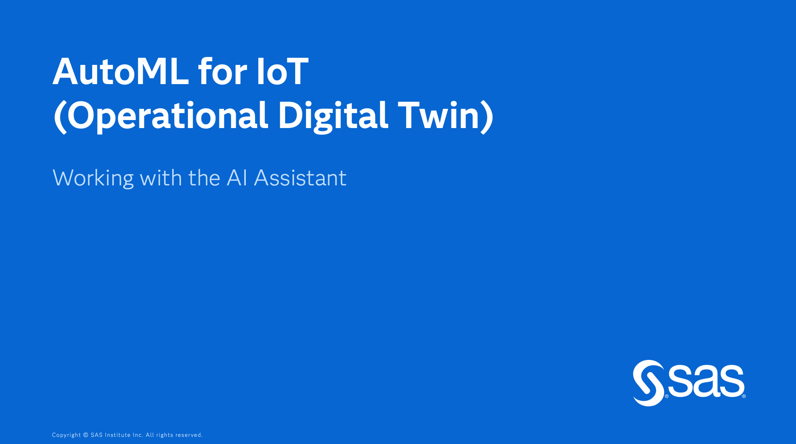

# Working With the AI Assistant

SECURITY NOTE:
The AI assistant provided at the link below has been set up as a custom GPT in ChatGPT. Therefore, from a security perspective, it is the same as any other chat initiated with an AI assistant. Users should ensure they do not share sensitive information or intellectual property during the chat. We recognize that users may have their own preferred AI provider which has been set up according to specific security policies. Therefore, we've also provided the knowledge documents needed to inform the assistant in the knowledge-documents subdirectory of this page. Feel free to copy the instructions and associated knowledge documents into your AI engine of choice and begin the conversation there.

Users can chat with our AI assistant by clicking on the AI Assistant image below. At the end of the conversation, the assistant will export a consolidated json file (and potentially a historical csv dataset) which can then be imported directly into AutoML for IoT. See the below powerpoint to understand what to expect during that conversation - and to learn how to import the consolidated json into SAS AutoML for IoT.

AI Assistant         | Step-by-Step Guide         |  
:-------------------------:|:-------------------------:|
 |   |

       